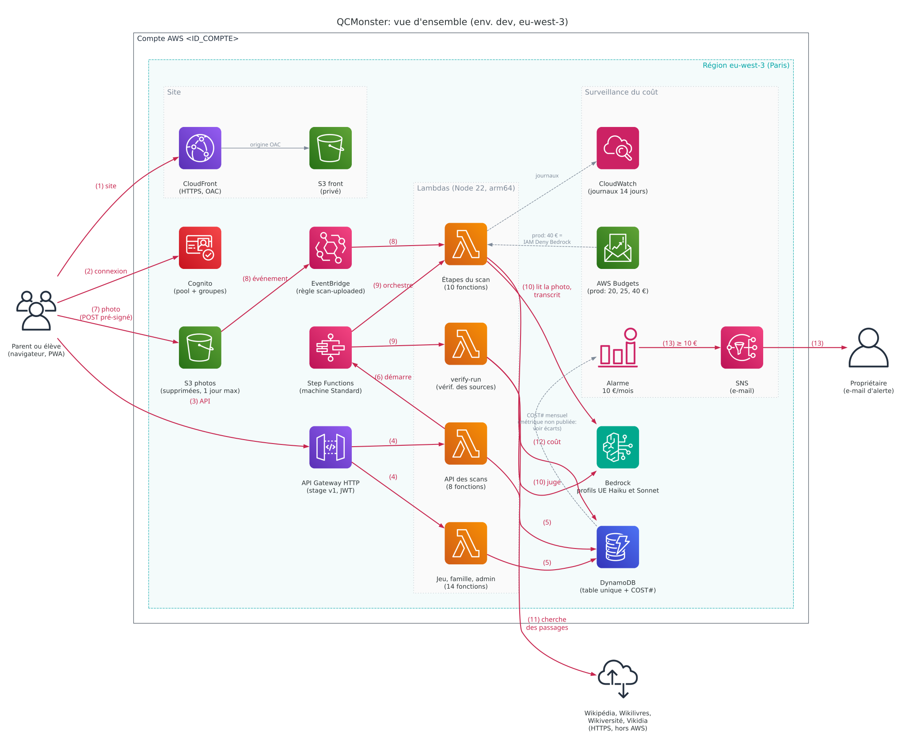

# 0. Vue d'ensemble

1 et 2. Le navigateur charge le site (HTML, JavaScript) depuis CloudFront, qui lit le bucket S3 privé. L'utilisateur se connecte directement à Cognito et reçoit des jetons.
3. Le site appelle l'API Gateway HTTP avec le jeton. API Gateway vérifie le jeton avant de continuer.
4 et 5. API Gateway envoie la requête à la bonne fonction Lambda: jeu et famille (14 fonctions) ou API des scans (8 fonctions). Les fonctions lisent et écrivent dans DynamoDB (une seule table).
6. La fonction « scans-create » démarre la machine Step Functions.
7. La photo part directement du navigateur vers le bucket S3 des photos (envoi pré-signé).
8. S3 prévient EventBridge, qui appelle la fonction « scan-start ». Elle réveille la machine qui attendait la photo.
9 et 10. Step Functions appelle les 10 fonctions d'étape et la fonction « verify-run ». Les étapes lisent et écrivent le texte avec Bedrock (profils UE, Haiku). « verify-run » juge les affirmations avec Sonnet.
11. « verify-run » cherche des passages sur les sites wiki (Wikipédia, Wikilivres, Wikiversité, Vikidia).
12. Chaque appel de modèle ajoute son coût au compteur « COST# » dans DynamoDB.
13. Une alarme CloudWatch à 10 €/mois devrait prévenir par SNS puis e-mail. Aujourd'hui la mesure n'est jamais envoyée (voir D1-report). En prod, AWS Budgets (20, 25, 40 €) prévient aussi et à 40 € coupe Bedrock.
