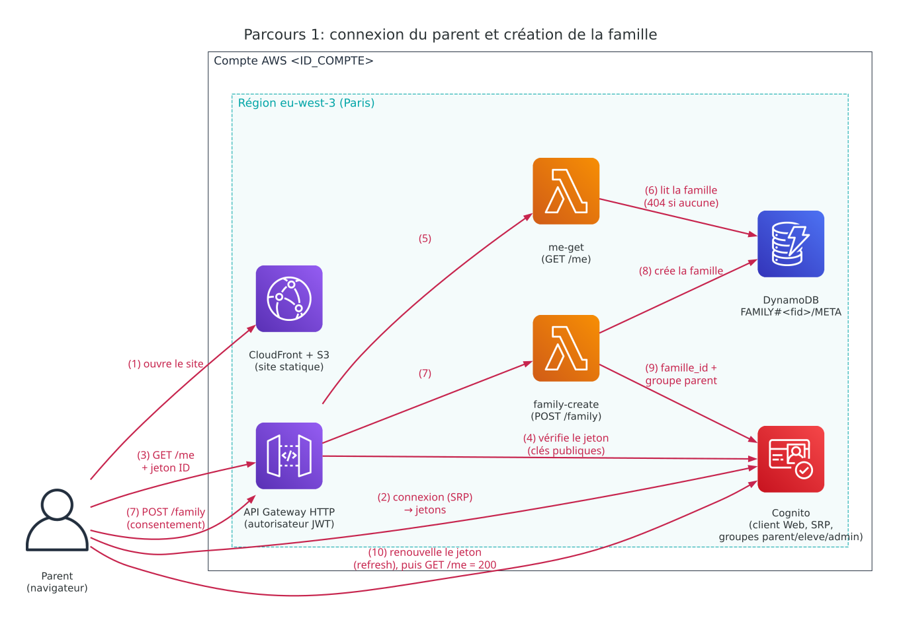

# 1. Connexion du parent et création de la famille

1. Le parent ouvre le site (CloudFront + S3).
2. Il se connecte à Cognito (mot de passe, double authentification proposée). Il reçoit des jetons valables 1 heure, renouvelables 30 jours.
3. Le site appelle « GET /me » avec le jeton d'identité.
4. API Gateway vérifie le jeton avec les clés publiques de Cognito.
5. La fonction « me-get » est appelée.
6. Elle cherche la famille dans DynamoDB. Un parent invité qui n'a pas encore de famille reçoit « 404 ».
7. Le site propose « Créer ma famille » et envoie « POST /family » avec le consentement. La fonction « family-create » le reçoit.
8. Elle écrit la famille (FAMILY#…/META) avec le consentement.
9. Elle donne à Cognito l'attribut « famille_id » et le groupe « parent ».
10. Le jeton déjà reçu ne contient pas encore ces valeurs: le site le renouvelle, puis « GET /me » répond 200.
