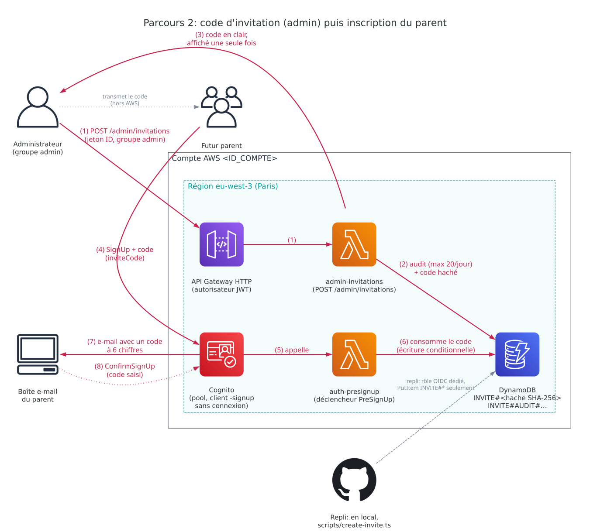

# 2. Code d'invitation (admin) et inscription du parent

1. L'administrateur (compte Cognito du groupe « admin ») envoie « POST /admin/invitations ». Le serveur lit le groupe dans le jeton et refuse tous les autres.
2. La fonction « admin-invitations » écrit deux choses dans DynamoDB: une ligne d'audit (20 codes par jour au plus) et le code, stocké haché (SHA-256).
3. Le code en clair revient à l'administrateur une seule fois. Il le donne au futur parent (hors AWS).
4. Le futur parent remplit la page d'inscription. Le site appelle Cognito (client « signup », sans connexion possible) avec le code.
5. Cognito appelle la fonction PreSignUp.
6. PreSignUp consomme le code par une écriture conditionnelle (existe et pas encore utilisé). Sinon: « invitation_invalide ».
7. Cognito envoie un e-mail avec un code à 6 chiffres.
8. Le parent saisit ce code (ConfirmSignUp). Ensuite, voir le schéma 1.

À savoir: AWS coupe lui-même l'auto-inscription du pool (erreur « SignUp is not permitted »). L'étape 4 est alors refusée avant l'étape 5 et le code n'est pas consommé. La création d'un compte parent par un administrateur (AdminCreateUser) n'existe pas dans le code: elle sert seulement aux élèves (schéma 3). Repli pour les codes: workflow GitHub « invite » ou « scripts/create-invite.ts ».
