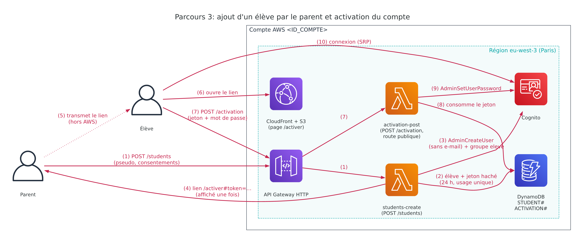

# 3. Ajout et activation d'un élève

1. Le parent envoie « POST /students » (pseudo, niveau, cases d'autorité parentale cochées). La fonction « students-create » le reçoit.
2. Elle écrit l'élève et un jeton d'activation dans DynamoDB. Le jeton est aléatoire, valable 24 h, à usage unique, stocké haché.
3. Elle crée le compte de l'élève dans Cognito (sans e-mail, sans message) et l'ajoute au groupe « eleve ».
4. Le parent reçoit le lien « /activer#token=… ». Il ne s'affiche qu'une fois. Le jeton est après le « # »: le serveur du site ne le voit jamais.
5. Le parent transmet le lien à l'élève (hors AWS).
6. L'élève ouvre le lien: CloudFront sert la page d'activation.
7. Il choisit son mot de passe. Le site envoie « POST /activation » (route publique, sans jeton de connexion).
8. La fonction « activation-post » vérifie le jeton et le consomme. Jeton inconnu, expiré ou utilisé: toujours la même réponse « 404 ».
9. Elle pose le mot de passe dans Cognito (AdminSetUserPassword).
10. L'élève se connecte à Cognito avec son pseudo.
