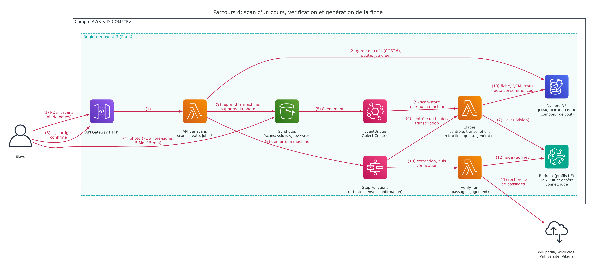

# 4. Scan d'un cours

1. L'élève demande un scan (« POST /scans », nombre de pages). Les PDF sont refusés, seules les images JPEG et PNG passent.
2 et 3. La fonction lit le compteur de coût (refus à 15 €/mois), réserve les pages du quota et crée le job dans DynamoDB. Elle démarre la machine Step Functions, qui attend la photo (15 minutes au plus).
4. L'élève envoie la photo directement à S3 (5 Mo au plus par image).
5 et 6. S3 prévient EventBridge, qui appelle « scan-start ». La machine reprend. Elle contrôle le fichier (les premiers octets doivent être JPEG ou PNG), puis lance la transcription.
7. Haiku (vision, profil UE) lit la photo. Le texte est gardé 7 jours, au plus 10 transcriptions par élève et par jour.
8 et 9. L'élève relit la transcription, corrige, confirme (ou annule). Sans réponse après 30 minutes, tout est annulé. La confirmation réveille la machine et la photo est supprimée.
10. Extraction des affirmations (Haiku), puis vérification.
11. « verify-run » cherche des passages sur les wikis.
12. Sonnet juge chaque affirmation (seconde lecture si doute). Plafond de 0,25 € par job.
13. Haiku écrit la fiche, les QCM et les textes à trous, puis le quota est consommé et la fiche publiée. Chaque appel ajoute son coût au compteur.
