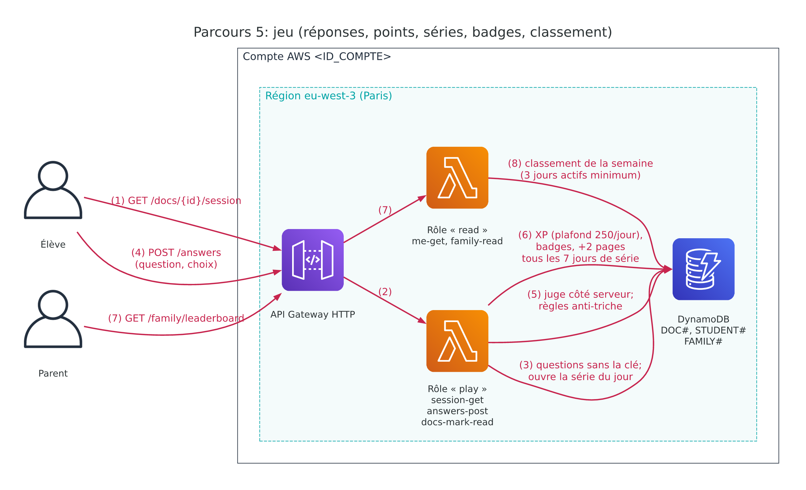

# 5. Jeu: réponses, points, séries, badges, classement

1. L'élève ouvre une fiche: « GET /docs/{id}/session ».
2. API Gateway appelle la fonction « session-get » (rôle « play »).
3. Elle lit les questions dans DynamoDB, sans les bonnes réponses, et ouvre la série du jour.
4. L'élève répond: « POST /answers » (question et choix).
5. Le serveur juge la réponse. Anti-triche: réponse en moins de 1 s refusée, série de 10 en moins de 20 s sans bonus, plus de 100 bonnes réponses en 10 min = gains bloqués pour la journée.
6. Il écrit les points (250 par jour au plus), la série (un jour compte à partir de 30 points), les badges (12 au catalogue) et le bonus de +2 pages tous les 7 jours de série (6 par mois et par famille au plus).
7. Le parent demande le classement: « GET /family/leaderboard ». La fonction « family-read » (rôle « read ») est appelée.
8. Elle lit le classement de la semaine. Un élève y figure à partir de 3 jours actifs.
