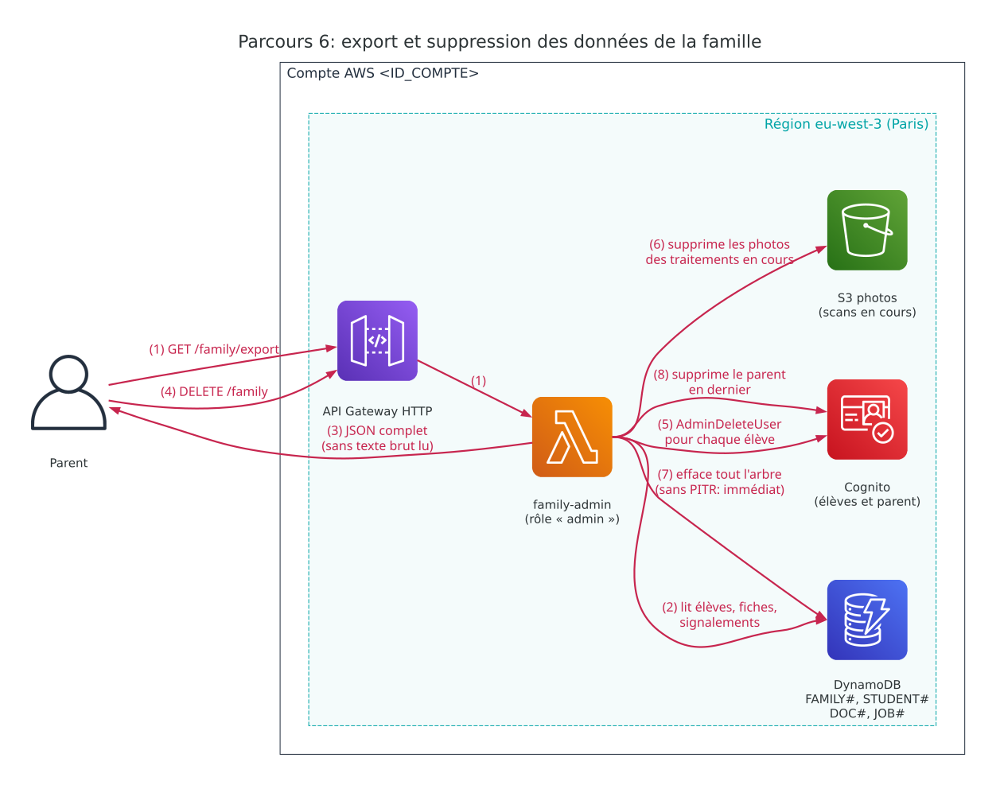

# 6. Export et suppression des données

1. Le parent demande « GET /family/export ». La fonction « family-admin » (rôle « admin ») le reçoit.
2. Elle lit dans DynamoDB les élèves, les fiches, les questions et les signalements, en partant de la famille du jeton seulement.
3. Elle renvoie un fichier JSON au parent. Le texte brut lu sur les photos n'est pas inclus.
4. Pour tout supprimer, le parent envoie « DELETE /family ».
5. Pour chaque élève, la fonction supprime son compte dans Cognito.
6. Elle supprime les photos des traitements en cours dans S3.
7. Elle efface tout l'arbre de la famille dans DynamoDB (jetons d'activation compris). Il n'y a pas de sauvegarde: c'est immédiat.
8. Elle supprime le compte du parent en dernier. Si une étape échoue, le parent peut relancer.

La suppression d'un seul élève (« DELETE /students/{sid} ») suit les étapes 5 à 7 pour cet élève.
