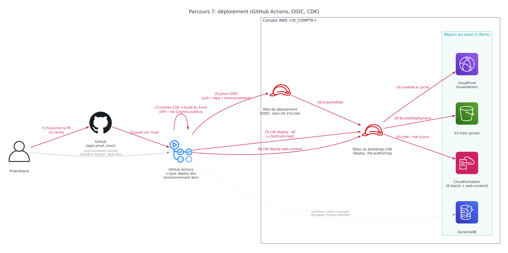

# 7. CI/CD: GitHub Actions, OIDC, CDK

1. Le propriétaire fusionne une pull request quand la CI est verte (lint, tests, synthèse CDK).
2. Le push sur « main » lance le workflow « deploy ». Il refait d'abord la CI, puis le job « deploy-dev » (environnement GitHub « dev »). Rien ne se déploie tant que la variable DEPLOY_ENABLED n'est pas « true ».
3. GitHub Actions demande un jeton OIDC. Il prouve le dépôt et l'environnement. Aucune clé d'accès n'est stockée.
4. AWS échange ce jeton contre le rôle de déploiement. Ce rôle sert seulement à endosser les rôles du bootstrap CDK.
5. « cdk deploy --all » (avec « -c bedrock=real ») passe par ces rôles.
6. CloudFormation crée ou met à jour les stacks (data, auth, api, models, budget, pipeline, verify, game, web).
7. Les sorties CDK donnent l'adresse de l'API et les identifiants publics Cognito. Le front est construit avec ces valeurs.
8. « cdk deploy qcm-dev-web-content » publie le front.
9. Il copie les fichiers dans le bucket S3 et invalide le cache CloudFront.

La prod se lance à la main (« workflow_dispatch », cible prod) après dev. Le workflow « invite » (manuel) utilise un autre rôle, limité à l'écriture des codes d'invitation.
