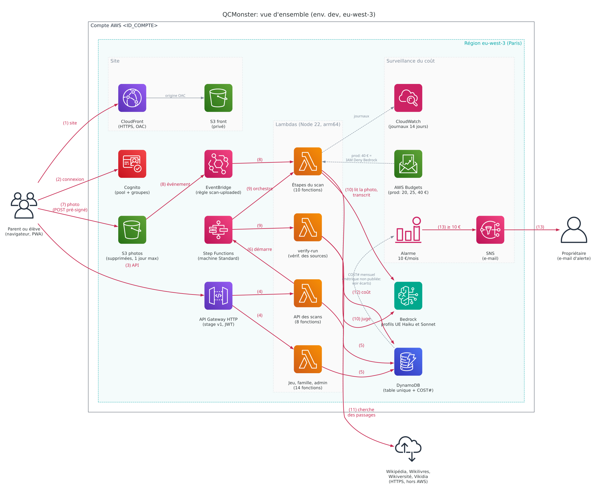
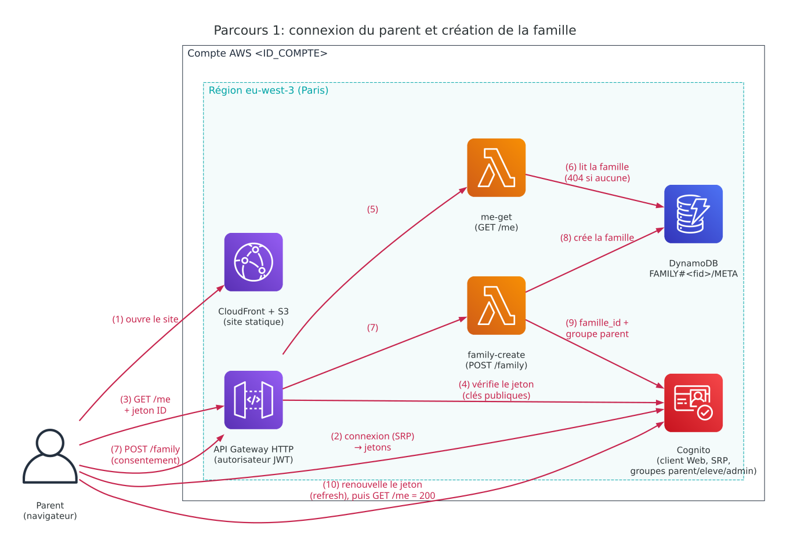
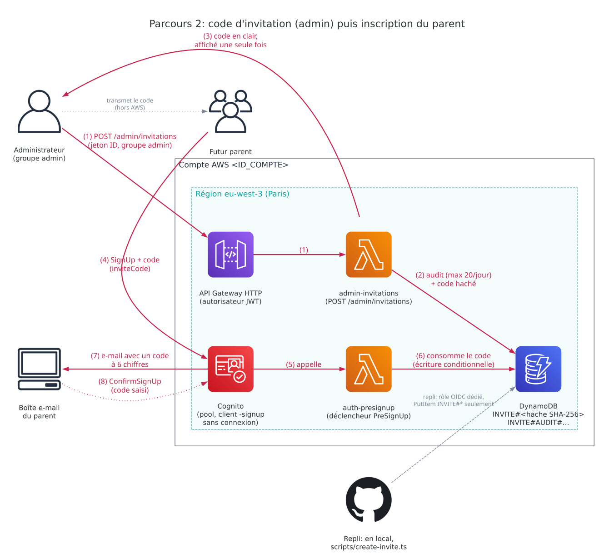
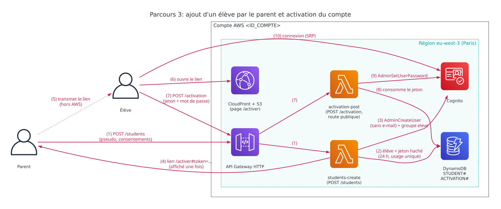
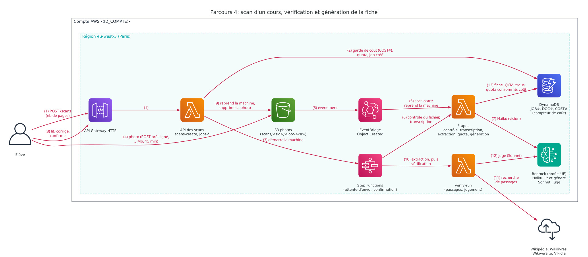
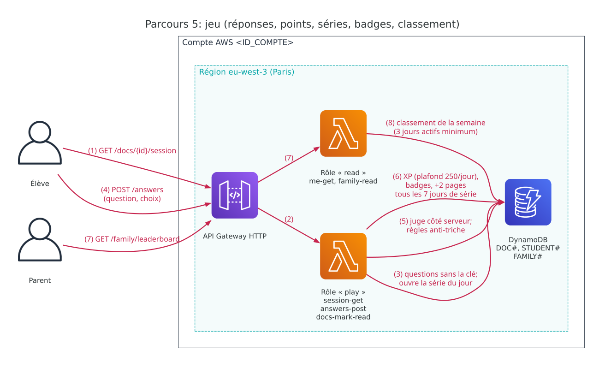
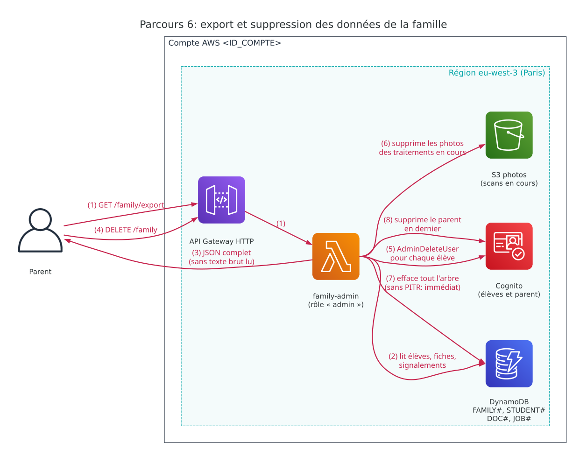
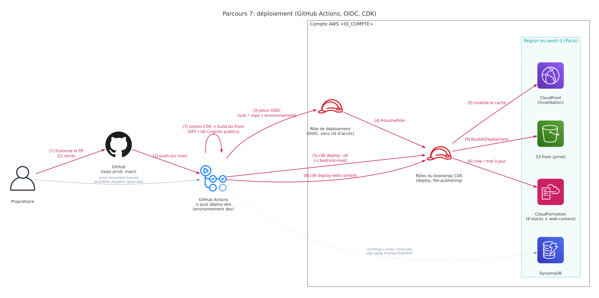

# Schémas d'architecture QCMonster

Un schéma par parcours, dessiné d'après le code déployé (`infra/lib/*.ts`, `api/src`, `.github/workflows`, `web/src`).
Chaque schéma a son fichier `.md` en français simple, qui suit les numéros des flèches.

| Schéma | Explication |
|---|---|
|  | [0. Vue d'ensemble](00_vue_ensemble.md) |
|  | [1. Connexion du parent et création de la famille](01_connexion_parent.md) |
|  | [2. Code d'invitation (admin) et inscription du parent](02_admin_invitation_inscription.md) |
|  | [3. Ajout et activation d'un élève](03_eleve_activation.md) |
|  | [4. Scan d'un cours](04_scan.md) |
|  | [5. Jeu](05_jeu.md) |
|  | [6. Export et suppression des données](06_export_suppression.md) |
|  | [7. CI/CD](07_cicd.md) |

## Lire un schéma
- Cadre plein: compte AWS. Cadre pointillé turquoise: région `eu-west-3`. Cadre gris pointillé: groupe de services.
- Flèche rouge numérotée `(n)`: le parcours, dans l'ordre. Deux flèches de même numéro se font en parallèle.
- Flèche grise pointillée: lien secondaire (journaux, repli, mesure).
- Les identifiants réels (compte, pool, adresse CloudFront) n'apparaissent jamais: `<ID_COMPTE>`, `<POOL>`.

## Régénérer
Le dépôt garde les SVG (lisibles sur GitHub). Les PNG sont générés aussi par `build.sh` mais ignorés par git: la garde `scripts/guards.test.ts` interdit les `.png` hors de ses dossiers prévus.
Les images sortent de `NN_*.py` (bibliothèque Python [`diagrams`](https://diagrams.mingrammer.com/), icônes AWS embarquées dans la bibliothèque) et de `common.py` (styles, flèches numérotées).
Les icônes sont celles livrées avec la bibliothèque; ce n'est pas forcément la dernière version du jeu « AWS Architecture Icons ».

```bash
python3 -m venv <VENV> && <VENV>/bin/pip install diagrams
export QCM_DIAGRAMS_VENV=<VENV>
./build.sh            # tous les schémas, ou: ./build.sh 04_scan.py
```

`diagrams` appelle Graphviz (`dot`). Si `dot` est installé (`apt install graphviz`), `build.sh` l'utilise.
Sinon `build.sh` cherche un adaptateur `dot` dans `<VENV>/shim`. Il a servi ici (aucun Graphviz natif sur la machine):
Graphviz compilé en WebAssembly (`@viz-js/viz`) et rendu PNG par `@resvg/resvg-js`, installés dans `<VENV>/node` (`npm i @viz-js/viz @resvg/resvg-js`).
Adaptateur `<VENV>/shim/dot` (script shell: `exec node <VENV>/shim/dot.mjs "$@"`) et `<VENV>/shim/dot.mjs`:

```js
// dot shim: graphviz (wasm via @viz-js/viz) + resvg, since no native graphviz is installed
import { instance } from '<VENV>/node/node_modules/@viz-js/viz/dist/viz.js';
import { Resvg } from '<VENV>/node/node_modules/@resvg/resvg-js/index.js';
import fs from 'fs';
const a = process.argv.slice(2);
let fmt = 'png', out = null, inp = null;
for (let i = 0; i < a.length; i++) {
  if (a[i].startsWith('-T')) fmt = a[i].slice(2);
  else if (a[i] === '-o') out = a[++i];
  else if (a[i] === '-O') out = 'AUTO';
  else if (a[i] === '-K') { }
  else if (!a[i].startsWith('-')) inp = a[i];
}
if (out === 'AUTO') out = inp + '.' + fmt;
const src = fs.readFileSync(inp, 'utf8');
const imgs = new Map();
for (const m of src.matchAll(/image\s*=\s*"([^"]+)"/g)) {
  const p = m[1]; if (imgs.has(p)) continue;
  const b = fs.readFileSync(p);
  imgs.set(p, { name: p, width: b.readUInt32BE(16), height: b.readUInt32BE(20) });
}
const viz = await instance();
let svg = viz.renderString(src, { format: 'svg', images: [...imgs.values()] });
// Les libellés des noeuds-icônes chevauchent le bas de l'icône avec viz wasm: on les descend sous l'image.
svg = svg.replace(/<g id="node\d+" class="node">[\s\S]*?<\/g>/g, (g) => g.includes('<image') ? g.replace(/(<text [^>]*? y=")(-?[\d.]+)(")/g, (m, a, y, c) => a + (parseFloat(y) + 30) + c) : g);
// embed images as data URIs so the SVG is self-contained
svg = svg.replace(/xlink:href="([^"]+\.svg)"/g, (s, p) => fs.existsSync(p) ? `xlink:href="data:image/png;base64,${fs.readFileSync(p).toString('base64')}"` : s);
if (fmt === 'svg') { fs.writeFileSync(out, svg); }
else {
  const r = new Resvg(svg, { font: { loadSystemFonts: true, defaultFontFamily: 'DejaVu Sans' }, fitTo: { mode: 'zoom', value: 1.5 }, background: 'white' });
  fs.writeFileSync(out, r.render().asPng());
}
```

Limite: `diagrams` ne sait pas ranger les flèches à la main; si deux libellés se touchent, changer l'ordre de déclaration des noeuds ou raccourcir un libellé.
