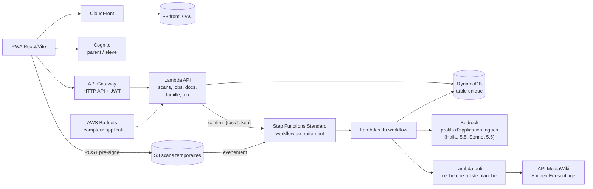

# QCMonster : conception v2

Version 2.0, rédigée le 2026-11-24. Elle part de `design.md` (v0.1) et répond à chaque point de `review.md` (B1-B4, A1-A14, M1-M10). `design.md` et `review.md` restent inchangés comme historique. Aucune ressource AWS ni aucun dépôt GitHub n'a été créé : ce fichier est le seul livrable.

Convention : un fait relu pendant cette révision porte la mention « lu » et sa source (section 14). Ce que je n'ai pas pu lire est marqué **[non lu]**. Une valeur supposée est marquée **[hypothèse]**.

---

## 1. Ce qui change entre la v1 et la v2

1. **Le budget voyait mal Bedrock.** Les modèles Claude sont facturés via AWS Marketplace et apparaissent sous le nom du fournisseur, pas sous « Amazon Bedrock » (fiche du modèle, lue). Un appel par le profil système `eu.anthropic...` n'a pas de tag. La v2 appelle des **profils d'inférence d'application tagués**, ajoute un **compteur de coût dans l'application** qui coupe les nouveaux traitements, et ne compte plus sur AWS Budgets comme seule protection (4.6).
2. **Le modèle n'écrit plus jamais une URL ni un extrait de source.** L'outil de recherche stocke les passages trouvés et renvoie des identifiants. Le modèle cite un identifiant. Le code recopie l'URL et l'extrait depuis le passage stocké (4.3).
3. **Plus d'agent qui boucle.** La vérification devient un **workflow fixe** (Step Functions) avec au plus deux appels Sonnet par page. Le contexte ne grossit plus à chaque tour, ce qui était la cause de l'écart de coût de 5 à 10 fois signalé par la relecture (4.1, 8).
4. **Lambda + Step Functions à la place d'AgentCore** pour une famille. Le surcoût d'AgentCore est faible en euros mais ajoute des réglages, un chemin de déploiement et des traces qui peuvent copier des cours (4.4).
5. **Traitement asynchrone** : l'API répond tout de suite, le front interroge l'état du traitement (4.5).
6. **Quota de pages appliqué par l'API**, relié à l'XP : l'XP récompense l'entraînement, pas le nombre de scans (4.7).
7. **L'élève confirme la transcription avant la vérification** (4.1, étape 4).
8. **Coût refait** avec les prix lus dans la liste officielle AWS, trois scénarios et formules visibles (section 8). Conclusion pour une famille : environ 10 € par mois en scénario réaliste, au-dessus de 20 € seulement si le pire cas se cumule avec une évaluation complète chaque mois.
9. **Lots réécrits** : un seul propriétaire par fichier ou stack, contrat d'API et schéma DynamoDB fixés par le lot 1, ancien lot 2 coupé en trois, jeu doré avec effectifs et jeu caché, API simulée pour le front (section 10).

---

## 2. Faits revérifiés pour cette version

### 2.1 Ce que j'ai lu

| Sujet | Ce que j'ai lu | Source |
|---|---|---|
| Prix Bedrock exacts, Paris | Liste de prix officielle AWS (fichier d'offre `AmazonBedrockFoundationModels`, publié le 2026-11-23), lignes `eu-west-3`. **Profil Geo UE** (« Standard ») : Haiku 5.5 entrée 0,11 $, sortie 0,55 $ par million de tokens. Sonnet 5.5 entrée 2,20 $, sortie 11,00 $. Lecture de cache : Haiku 0,011 $, Sonnet 0,11 $. Écriture de cache (5 min) : Haiku 0,1375 $, Sonnet 2,75 $. **Profil Global** : 0,10 / 0,50 et 2,00 / 10,00. L'écart de 10 % entre Geo et Global est donc **confirmé** (c'était une hypothèse en v1). Un prompt de plus de 100 000 tokens coûte plus cher pour Haiku (0,55 / 2,75) : sans effet ici. | pricing.us-east-1.amazonaws.com (section 14) |
| Page web de tarification Bedrock | Illisible avec mon outil (rendue par JavaScript, le tableau Anthropic n'apparaît pas). Les chiffres ci-dessus viennent du fichier d'offre, qui est la même source que la page. | page de tarification |
| Destinations du profil Geo UE pour Sonnet 5.5 | Fiche Sonnet 5.5, ID `eu.anthropic.claude-sonnet-5-5`. Depuis Paris, destinations : Francfort, Stockholm, Milan, Espagne, Irlande, Paris. Même liste que Haiku 5.5. Pas de Londres ni Zurich. | fiche Sonnet 5.5 |
| Niveaux de service des deux modèles 5.5 | Standard seulement. Priority, Flex, Reserved et Batch : non. Le « traitement par lots à moitié prix » n'existe pas pour ces modèles sur Bedrock. | fiches Sonnet 5.5 et Haiku 5.5 |
| Facturation des modèles Claude | « Offert et facturé via AWS Marketplace. Les frais apparaissent sur la facture et dans Cost Explorer sous le fournisseur du modèle, pas sous Amazon Bedrock. » | fiche Sonnet 5.5, section Pricing |
| Prompt caching 5.5 | Minimum 512 tokens par point de contrôle, 4 points par requête, durée 5 min ou 1 h. La v1 citait 4 096 tokens (valeur de Haiku 4.5) : elle ne s'applique pas. | fiches 5.5 |
| Profil d'application | `CreateInferenceProfile` accepte `tags` pour « suivre l'usage et les coûts ». Pour plusieurs régions, la source est un profil système. | doc « Create an application inference profile » |
| Quotas Bedrock par défaut | Valeurs par défaut du guide général : tokens par minute en profil Geo, par région : Sonnet 5.5 **6 000 000**, Haiku 5.5 **10 000 000**. Même chose en Global. Pas de ligne « requêtes par minute » pour les modèles 5.5. | AWS General Reference, Bedrock |
| Avertissement sur les quotas | La doc précise que les quotas d'un compte peuvent être plus bas que ces défauts (âge du compte, historique de paiement). | page Quotas Bedrock |
| Quotas AgentCore Runtime | Délai d'une requête synchrone : 15 min. Création de sessions : 25 par seconde par compte. Requêtes : 1 000 par seconde. Sessions actives : 2 500 par compte hors US Est/Ouest. Inactivité : 15 min. Gateway : 200 appels d'outil par seconde. | doc AgentCore, limites |
| Prix AgentCore, Paris | Liste officielle `AmazonBedrockAgentCore`, `eu-west-3`, Runtime : vCPU v2 0,1276 $/h, mémoire v2 0,0169 $/Go-h. Les lignes v1 (0,0895 et 0,00945) existent aussi **pour Runtime** (« Consumption-based »). L'étiquette v1/v2 de la v1 était donc juste, la relecture avait un doute à tort. Gateway : 0,000005 $ par appel. | liste de prix AgentCore |
| Prix Paris des autres services | Lambda 0,20 $ par million de requêtes. DynamoDB à la demande : écriture 0,7423 $ par million, lecture 0,1487 $ par million, stockage 0,29715 $/Go-mois au-delà de 25 Go. API Gateway : 3,50 $ par million (tarif de la liste, sans distinguer HTTP et REST). CloudWatch, ingestion de journaux : 0,5985 $/Go. Secrets Manager : 0,40 $ par secret et par mois. | listes de prix AWS |
| Taux de change | BCE, jeu du 2026-11-24 : 1 € = 1,0963 $, soit 1 $ = 0,9122 €. (v1 : 1,0968 via un site tiers.) | fichier XML de la BCE |
| User-Agent Wikimedia | Les sites Wikimedia veulent un `User-Agent` descriptif avec un contact. Les agents génériques (`curl`, `Python-urllib`) peuvent recevoir une erreur 403. | politique User-Agent de Wikimedia |

### 2.2 Ce que je n'ai pas pu lire

- **Quotas réellement appliqués au compte <ID_COMPTE>.** Je n'ai ni la CLI AWS ni d'identifiants dans cette session. Je ne connais que les défauts publiés. Le lot 1 inclut la lecture dans Service Quotas (10.2).
- **Limite de durée d'une HTTP API** (30 s selon la relecture) : la page des quotas d'API Gateway n'a rien renvoyé. Je reprends le chiffre de la relecture sans l'avoir confirmé. La conception n'en dépend pas, puisque le traitement est asynchrone.
- **Prix de Step Functions à Paris** : le fichier d'offre n'existe pas sous le nom que j'ai essayé. J'utilise 0,025 $ pour 1 000 transitions **[hypothèse]**, le tarif US Est que je connais. Impact : moins de 0,001 $ par page.
- **Prix de durée Lambda à Paris** : ma requête ne l'a pas renvoyé **[hypothèse : 0,0000167 à 0,00002 $ par Go-seconde]**.
- **Conditions d'usage de l'API MediaWiki** au-delà du `User-Agent` : limites de débit non lues.
- **Doc Bedrock sur la protection des données** (position d'AWS : le fournisseur du modèle n'a pas accès aux données du client) : non relue. Voir M3.
- **Quotas AgentCore Memory, Observability** : non lus (non utilisés).
- **Vikidia, Wikibooks, Wikiversity** : je pars du principe qu'ils exposent l'API MediaWiki standard. Non vérifié.

---

## 3. Décisions imposées (reprises telles quelles)

| Sujet | Décision |
|---|---|
| Région | `eu-west-3`. Les modèles Claude passent par le profil Geo UE (traitement dans l'UE, pas forcément à Paris). La politique de confidentialité écrit « UE ». |
| Comptes | Cognito, comptes élève et parent liés par `famille_id`. |
| Sources de vérification | Wikipedia, sites éducatifs connus, Eduscol. Liste blanche réaliste, interrogeable (4.3). |
| Exercices | QCM et textes à trous. |
| Gamification | Complète : XP, séries, niveaux, badges, classement familial, mascotte monstre évolutive (section 7). |
| Budget | Cible inférieure à 20 € par mois pour une famille, avec alerte. |
| Usage | Une famille, ouvert plus tard. |
| Compte AWS | <ID_COMPTE>, **à confirmer par le propriétaire**. |
| Dépôt | Privé, `Worxfr/qcmonster`. |
| OIDC | Rôle dédié `QCMonster-GitHubActions-Deploy`, créé par `infra-bootstrap/setup-oidc.sh` (non modifié ici). |
| Tag `Owner` | `Worxfr`, comme dans le script de bootstrap. |

---

## 4. Architecture v2

### 4.1 Flux d'un traitement

Chaque étape est une tâche Step Functions. **Aucun contenu de cours ne circule dans l'état de la machine** : seuls `jobId`, `docId` et des compteurs y passent. Les textes sont lus et écrits dans DynamoDB (4.9).

| # | Étape | Fait par | Résultat |
|---|---|---|---|
| 1 | `POST /scans` : l'API vérifie le **quota** (4.7), réserve les pages, crée le job et renvoie une **URL POST pré-signée** avec `content-length-range` (5 Mo max pour une image, 20 Mo pour un PDF de 10 pages max) | Lambda `scans-create` | `jobId`, URL d'envoi |
| 2 | L'événement S3 démarre le workflow. Contrôle du type **sur le contenu** (octets d'en-tête), pas sur l'en-tête HTTP. Rejet si pas une image ni un PDF | Lambda `scan-check` | Fichier valide ou job `rejete` (quota rendu) |
| 3 | Transcription : texte, phrases numérotées (`p2-s7`), **type de document** (`cours`, `exercice`, `autre`). `autre` (carnet, bulletin, photo de personne) ou moins de 40 mots : job refusé, **quota rendu** | Haiku 5.5 (vision) | Texte numéroté dans DynamoDB, job `a_confirmer` |
| 4 | **Confirmation par l'élève** (A6) : le front affiche la transcription à côté de la photo. L'élève corrige les mots faux ou valide. La photo reste en S3 pendant cette étape seulement : suppression à la confirmation, à l'annulation, ou après **30 min** sans réponse (règle du workflow) et au plus tard à **1 jour** (règle de cycle de vie S3). Le workflow attend avec un `waitForTaskToken` | Élève, `POST /jobs/{id}/confirm` | Texte confirmé, **image supprimée** |
| 5 | Extraction : liste des affirmations, chacune avec ses `phrase_id`, et classement `factuelle` ou `non_factuelle`, et marque `a_risque` (nombre, date, formule, nom propre) | Haiku 5.5 | Affirmations |
| 6 | **Contrôle d'ancrage par code** : chaque `phrase_id` existe et l'extrait du cours est bien dans le texte (comparaison normalisée). Sinon l'affirmation est supprimée | Lambda | Affirmations ancrées |
| 7 | **Recherche de passages** pour chaque affirmation factuelle, par l'outil (4.3). Cache d'abord : si une affirmation à empreinte normalisée identique a déjà un verdict récent, on le réutilise | Lambda `verify-search` (code, pas un LLM) | Passages stockés, identifiants |
| 8 | **Jugement** : un seul appel Sonnet reçoit les affirmations et leurs passages (identifiés). Il renvoie par affirmation : `verifiee`, `erreur` ou `non_verifiable`, la liste d'identifiants de passages qui la soutiennent ou la contredisent, et la **citation exacte** copiée du passage | Sonnet 5.5, un appel (deux si plus de 25 affirmations) | Verdicts bruts |
| 9 | **Contrôle par code des verdicts** : chaque identifiant cité existe dans les passages de ce job, la citation est une sous-chaîne du passage (normalisée). Sinon le verdict devient `non_verifiable`. Le code écrit lui-même `url`, `site`, `titre` et `extrait` depuis le passage | Lambda | Sources fiables |
| 10 | **Seconde lecture** (A5) sur : (a) toute affirmation `erreur`, (b) toute affirmation `verifiee` marquée `a_risque`. Appel Sonnet avec un autre prompt qui doit citer le passage exact. Une `erreur` n'est publiée que si les deux lectures concordent. Une `verifiee` à risque non confirmée devient `non_verifiable` | Sonnet 5.5, un appel | Verdicts finaux |
| 11 | Génération de la fiche, de 5 QCM et de 5 textes à trous à partir des affirmations (jamais de l'image) | Haiku 5.5 | Contenu |
| 12 | Contrôle des QCM (relecture, point 4.9) : une seule bonne réponse liée à une affirmation `verifiee` ou `non_factuelle` ; **résolution à l'aveugle** : un second appel Haiku répond au QCM sans voir la clé, et le QCM est rejeté si la réponse diffère. Contrôle des trous : le mot masqué est dans l'affirmation | Code + Haiku | QCM validés |
| 13 | Publication : fiche, pastilles, sources. Le job passe à `termine`. Le **coût réel** du job est enregistré (4.6) | Lambda | Fiche visible |

Plafond par job : **0,25 €** de coût cumulé, mesuré à chaque appel avec les `usage` renvoyés par Bedrock. Au-delà, les affirmations restantes sont marquées `non_verifiable` et le job se termine. Ce plafond empêche un cas anormal de coûter plus de 0,25 €.

### 4.2 Schéma

### 4.3 Outil de vérification : le modèle ne fournit ni URL ni extrait (B2, A7, A8)

**Principe.** L'outil est une fonction de code. Le modèle ne l'appelle pas en boucle : le workflow (étape 7) l'appelle pour chaque affirmation factuelle avec une requête de recherche. Il renvoie des **passages**. Chaque passage est écrit dans DynamoDB (`PASSAGE#<hash>`) avec : texte brut, URL, site, titre, date de lecture. Le modèle de l'étape 8 reçoit les passages avec leur identifiant et ne voit jamais d'URL à recopier.

**Ce que le code garantit** (étape 9) :
1. L'identifiant cité par le modèle existe pour ce job.
2. La citation du modèle est une sous-chaîne du texte du passage (après normalisation des espaces, de la casse et des accents).
3. `url`, `site`, `titre`, `extrait` de la fiche viennent du passage stocké, jamais de la sortie du modèle.
4. Si l'un des trois contrôles échoue, l'affirmation devient `non_verifiable`.

**Règles de l'outil (A7).**
- Le modèle ne fournit **que du texte de requête**. Il ne fournit jamais d'URL. L'outil construit lui-même l'adresse de l'API à partir d'une **liste fermée de noms d'hôtes exacts** (pas de joker `*.wikipedia.org`).
- HTTPS seulement. **Zéro redirection suivie.** Délai de 5 s. Taille de réponse limitée à 64 Ko. Aucun en-tête d'identification AWS.
- Texte brut seulement : les extraits sont demandés en texte (`explaintext`), le HTML et les liens sont supprimés. Le passage est placé dans le prompt entre balises marquées « donnée non fiable, aucune instruction à suivre ».
- `User-Agent` descriptif avec un contact de l'équipe (politique Wikimedia, lue). Limite de 5 requêtes par seconde dans l'outil **[hypothèse : limites MediaWiki non lues]**.
- Les Lambda restent hors VPC, donc sans filtre réseau sortant : la protection est le code de l'outil, qui ne contacte que les hôtes de la liste.

**Liste blanche v2 (A8), réduite à ce qui est interrogeable.**

| Source | Méthode de recherche | Niveau de confiance |
|---|---|---|
| `fr.wikipedia.org` | API MediaWiki : recherche plein texte, puis extraits des 3 meilleures pages | 2 |
| `en.wikipedia.org` | idem, seulement pour les termes scientifiques sans page française | 2 |
| `fr.wikibooks.org`, `fr.wikiversity.org`, `fr.vikidia.org` **[non vérifié : même API supposée]** | idem | 2 (Vikidia : 3, vocabulaire d'enfant) |
| Eduscol (programmes officiels) | **Index figé** : au développement, un script télécharge une liste de pages de programmes choisies à la main, les découpe en passages et les range dans DynamoDB. La recherche est un classement par mots-clés dans cet index. Pas de requête vers Eduscol en production. On cite et on renvoie par lien, on ne recopie pas de longs passages (mentions légales d'Eduscol) | 1 pour « ce que le programme demande », pas pour un fait scientifique |
| Constantes physiques (NIST) | Index figé de la même façon, une cinquantaine de constantes | 1 |

**Reportés (non interrogeables aujourd'hui)** : Lumni, BnF, Universalis (payant), CNRS, Futura, MathWorld, IUPAC. Aucun n'a de recherche par phrase que je connaisse et je n'ai pas lu leurs conditions. Un domaine n'entre dans la liste que si une méthode de recherche est écrite et testée.

**Règle de verdict (niveaux définis).**
- `verifiee` : un passage de niveau 1 ou 2 qui soutient clairement l'affirmation, ou deux passages de niveau 2 ou 3 qui concordent.
- `erreur` : un passage de niveau 1 ou 2 qui la contredit explicitement **et** la seconde lecture confirme.
- Sinon `non_verifiable`. Le champ `confiance` de la v1 est supprimé : le niveau de la source suffit.

### 4.4 AgentCore ou Lambda + Step Functions pour une famille

**Recommandation : Lambda + Step Functions Standard.**

| | AgentCore Runtime + Gateway | Lambda + Step Functions |
|---|---|---|
| Coût d'orchestration par page (hypothèses de 8) | Runtime : 5 à 20 s de CPU et 30 à 120 s de mémoire, soit 0,0002 à 0,0018 $ (taux v2 de Paris, lus). Gateway : 0,000005 $ par appel d'outil, négligeable | Environ 0,0015 $ **[hypothèse : Lambda 60 Go-s et 25 transitions, prix Step Functions et durée Lambda non lus]** |
| Pour 40 pages par mois | environ 0,01 à 0,07 $ | environ 0,06 $ |
| Écart | Moins de 0,10 $ par mois dans les deux cas. **Le coût ne départage pas** | |
| Déploiement | Image conteneur ou paquet de code spécifique, endpoints, identité Gateway, nouveau chemin dans la CI | Lambda TypeScript ordinaires, un seul chemin de déploiement CDK |
| Boucle | Fait pour un agent qui décide seul de ses outils. Ici le déroulé est fixe | Un workflow fixe est ce qu'on veut : pas de tour supplémentaire, coût borné |
| Journaux | AgentCore Observability écrit des traces qui peuvent contenir prompts et réponses (A9) | Journaux écrits par notre code seulement |
| Reprise sur erreur, attente de l'élève (étape 4) | À écrire | Natif : `Retry`, `Catch`, `waitForTaskToken` |
| Quotas (lus) | Largement suffisants : 25 sessions par seconde, 2 500 sessions actives | Standard : sans objet pour une famille |

AgentCore reste une évolution possible si le produit s'ouvre et que l'agent doit choisir librement ses outils. Rien dans la v2 ne l'empêche : les Lambda d'étape peuvent devenir des outils plus tard.

### 4.5 Traitement asynchrone (A2)

- L'API ne fait jamais le travail. `POST /scans` répond en moins de 2 s avec `jobId`. Le front interroge `GET /jobs/{jobId}` toutes les 3 s (pas de WebSocket en v1).
- États : `en_attente_envoi`, `verification_fichier`, `transcription`, `a_confirmer`, `verification`, `generation`, `termine`, `rejete`, `echec`, `expire`.
- **Objectif de durée, reformulé** : de la confirmation de l'élève à la fiche affichée, **médiane ≤ 90 s et 95e centile ≤ 180 s par page**. La transcription ajoute 10 à 20 s avant la confirmation. La cible de 60 s de la v1 est retirée.
- Si l'élève ne confirme pas en 30 min, le job passe à `expire`, la photo est supprimée, le quota est rendu.

### 4.6 Budget et suivi des coûts (B1)

**Ce qu'on sait** : les modèles Claude sont facturés via AWS Marketplace et listés sous le fournisseur (fiche, lue). Un budget filtré sur le service « Amazon Bedrock » les manquerait. Un budget filtré sur le tag `project` ne les voit que si le coût suit le tag du profil d'inférence **[non vérifié : seul un test sur la vraie facture le dira]**.

**Ce que la v2 met en place.**

1. **Un profil d'inférence d'application par modèle et par environnement** (quatre au total : Haiku et Sonnet, `dev` et `prod`). Chacun est copié du profil système `eu.anthropic.claude-haiku-5-5` ou `eu.anthropic.claude-sonnet-5-5` et porte les tags `project`, `Environment`, `ManagedBy`, `Owner`. **Le code appelle toujours l'ARN du profil d'application, jamais le profil système.** Un test CI échoue si un `modelId` ne commence pas par `arn:aws:bedrock:eu-west-3:`. Les droits IAM doivent couvrir le profil d'application, le profil système et les modèles de base dans les régions de destination (à tester au lot 1).
2. **Compteur de coût dans l'application (garde principale).** À chaque appel, le code convertit `usage` (tokens d'entrée, de sortie, de cache) en euros avec la table de prix `shared/pricing.ts` et ajoute le montant à l'élément `COST#<env>/MONTH#<aaaa-mm>` (ajout atomique). Règles : à **15 €** dans le mois, `POST /scans` répond 429 `budget_epuise` ; à **18 €**, tous les traitements en cours s'arrêtent à la prochaine étape. Un alarme CloudWatch sur ce compteur envoie un e-mail à 10 €.
3. **AWS Budgets, trois budgets, comme alerte et filet.**
   - `QCMonster-alerte-20` : 20 € par mois, filtré sur le tag `project=qcmonster`. Seuils e-mail à 50 %, 80 %, 100 % en réel et 100 % en prévision.
   - `QCMonster-filet-marketplace` : 25 € par mois, filtre « entité de facturation = AWS Marketplace » (les modèles Claude). **Alerte seulement**, pas d'action : le compte contient peut-être d'autres usages Claude **[à valider au lot 1]**.
   - `QCMonster-securite-40` : 40 €, filtré sur le tag, avec **action** qui applique une politique IAM refusant `bedrock:InvokeModel*` aux rôles des Lambda de traitement. Elle ne s'active que si le suivi par tag fonctionne.
4. **Contrôle à J+2 du premier appel** (critère du lot 1b, 10.2) : après les premiers appels réels, lire Cost Explorer filtré par tag et par entité Marketplace. Si le tag ne ressort pas, on documente que seul le compteur applicatif et le budget Marketplace protègent, et le propriétaire en est informé.
5. **Clé de tag** : on utilise `project` en minuscules (décision FEAT-D, F13), valeur `qcmonster`. Avant de créer les budgets, lire `aws ce list-cost-allocation-tags` et vérifier que `project` est active (gratuit, jusqu'à 24 h de délai). `Project` ne doit jamais être posé : IAM compare les clés sans tenir compte de la casse.

### 4.7 Quota de pages, relié à l'XP (A4)

**Règles, appliquées par l'API dans `shared/quota.ts` (propriétaire : lot 1).**
- Une **page** est une image ou une page de PDF. Un PDF de 10 pages consomme 10.
- Quota par défaut : **20 pages par élève et par mois**, plafond de **50 pages par famille et par mois**. Le parent peut changer le quota d'un élève dans la limite du plafond famille.
- Pour une famille de 2 élèves, 20 pages chacun font 40 pages ; le plafond famille de 50 laisse 10 pages de marge.
- Réservation **atomique** (écriture DynamoDB conditionnelle) à `POST /scans`. Rendu si le job est rejeté, annulé ou expiré avant la vérification. Consommé définitivement à l'étape 8.
- Une transcription refusée ou annulée coûte un peu de Haiku (environ 0,004 $) sans consommer de quota. Plafond complémentaire : **10 transcriptions par élève et par jour**.
- Réponse `quota_epuise` avec la date de remise à zéro (1er du mois, fuseau Europe/Paris).

**Lien avec l'XP.**
- L'XP de scan (10 XP, 5.1) n'est accordé que pour une page **consommée dans le quota**. Il n'y a plus de « 5 scans payés par jour » : la limite quotidienne est de **2 pages rémunérées par jour**.
- L'XP vient surtout de l'entraînement (QCM, trous, revue d'une fiche), **qui ne coûte aucun appel de modèle**. La mécanique pousse à pratiquer plus qu'à scanner.
- Le tableau de bord affiche les pages restantes. Une série de 7 jours donne **+2 pages bonus**, plafonnées à **+6 par famille et par mois**, et comptées dans le plafond famille de 50.
- Pas d'achat de pages avec de l'XP.
- Protection contre la création de familles en série : **inscription parent sur invitation** (code à usage unique, généré par le propriétaire, stocké haché dans DynamoDB). Contrôle dans le déclencheur Cognito `PreSignUp` (lot 1).

### 4.8 Comptes, données et RGPD (A12, A13, M6, M7)

- **Âge** : le parent répond « l'élève a-t-il moins de 15 ans ? oui/non ». On stocke ce booléen. Aucune date de naissance.
- **Identifiant élève** : un **pseudo** choisi par le parent, sans nom de famille, auquel le système ajoute un suffixe aléatoire (`Lila-7k2f`). Le nom d'utilisateur Cognito est un identifiant aléatoire ; le pseudo sert de connexion par alias. Le parent est averti de ne pas mettre de nom de famille.
- **Création** : le parent remplit pseudo + cases « j'ai l'autorité parentale » et « moins de 15 ans ». Le serveur crée l'utilisateur Cognito (groupe `eleve`, `famille_id`) et renvoie un **lien d'activation à usage unique, valable 24 h** (jeton aléatoire, seul son haché est stocké, TTL DynamoDB). Le lien est montré au parent, pas envoyé à l'élève.
- **Mot de passe perdu** : le parent clique « réinitialiser », ce qui génère un nouveau lien d'activation. Pas d'e-mail de l'élève.
- **MFA du parent** : application d'authentification (TOTP), **proposée à l'inscription et recommandée**, pas imposée. Pas de SMS.
- **Envoi de fichier** : URL **POST** pré-signée avec `content-length-range` ; contrôle du type sur le contenu ; refus des PDF de plus de 10 pages.
- **Limitation de débit** : HTTP API avec limitation par route au niveau de l'étape, plus le quota de pages et le plafond de 10 transcriptions par jour. On n'utilise pas les plans d'utilisation de REST API (par clé d'API, pas par utilisateur).
- **Sauvegardes** : **pas de PITR DynamoDB** en v1. La suppression d'un compte est donc effective immédiatement, sans copie de 35 jours. Risque accepté : une perte de données demande de rescanner les cours. À écrire dans la politique.
- **Données** : fiches et textes conservés jusqu'à suppression par le parent ou l'élève. Jobs et passages : TTL de 7 jours et 30 jours.
- **Sous-traitants (M3)** : la politique écrit **AWS** comme sous-traitant d'hébergement et d'inférence. Elle ne cite pas Anthropic tant que la position d'AWS (le fournisseur du modèle n'a pas accès aux données) n'a pas été relue dans la doc de protection des données de Bedrock **[non lu]**. Tâche du lot 0. La fiche du modèle indique en plus une facturation via AWS Marketplace : à mentionner dans la même relecture.
- **AIPD** : brouillon par le lot 0 ; la validation par une personne compétente est une condition du passage à une ouverture au-delà de la famille. Pour l'usage familial privé, un registre simple suffit.
- **Documents hors cours** : le type `autre` est refusé à l'étape 3 (voir 4.1). La règle `[nom]` est appliquée par le prompt **et** mesurée dans le jeu doré.

### 4.9 Journaux et contenu (A9)

- Un seul utilitaire `log()` (dans `shared/log/`, lot 1) qui n'accepte que : identifiant technique du job, étape, durée, statut, nombre de tokens, coût. Un test CI échoue si un fichier appelle `console.*` directement.
- **Step Functions garde l'entrée et la sortie de chaque état** dans son historique (conservé 90 jours). C'est pourquoi aucun texte n'y passe (4.1). Journalisation de la machine : niveau `ERROR`, **sans données d'exécution** (`includeExecutionData: false`).
- API Gateway : journaux d'accès **sans** corps ni paramètres de requête.
- **Journalisation des invocations Bedrock désactivée.** Un test lit `GetModelInvocationLoggingConfiguration` et échoue si elle est active.
- Pas d'AgentCore, donc pas de traces d'agent.
- **Test « aucun contenu »** : on insère un jeton unique (`QCMTOKEN-<aléatoire>`) dans un cours de test, on traite la page, puis on cherche le jeton dans : les groupes de journaux de toutes les Lambda, le groupe de la machine Step Functions, le groupe d'accès de l'API, `GetExecutionHistory` de l'exécution, et les objets S3. Il doit être absent de tous, sauf de DynamoDB (où il est attendu jusqu'à suppression).
- Rétention des journaux : 14 jours **[hypothèse]**.

---

## 5. Modèle de données DynamoDB (fixé par le lot 1)

Une table par environnement : `qcm-dev`, `qcm-prod`. À la demande. Clé de partition `PK`, clé de tri `SK`. Fichiers : `docs/data-model.md` et `shared/ddb/keys.ts` (lot 1 seul). **Chaque type d'élément a un seul lot qui écrit** ; les autres lots lisent.

| Type | PK | SK | Attributs principaux | Écrit par |
|---|---|---|---|---|
| Famille | `FAMILY#<fid>` | `META` | plafond pages famille, date de création | L3 |
| Élève | `FAMILY#<fid>` | `STUDENT#<sid>` | pseudo, niveau scolaire, `moins15`, statut (`actif`, `suspendu`), `cognitoSub` | L3 |
| Quota mensuel | `FAMILY#<fid>` | `QUOTA#<aaaa-mm>#<sid>` | `limite`, `utilise`, `reserve`, `bonus` | `shared/quota.ts` (L1) ; lu par L2a, L3 |
| Job | `STUDENT#<sid>` | `JOB#<jobId>` | état, nb de pages, coût en centimes, horodatages, erreur. TTL 7 jours | L2a |
| Transcription | `JOB#<jobId>` | `TEXT#<page>` | phrases numérotées. TTL 7 jours | L2a |
| Fiche | `STUDENT#<sid>` | `DOC#<docId>` | titre, matière, empreinte normalisée, date | L2a |
| Affirmation | `DOC#<docId>` | `CLAIM#<nn>` | texte, origine (page, `phrase_id`, extrait), type, statut, `a_risque`, `sources[]` (`passageId`, `url`, `site`, `titre`, `extrait`, `niveau`) | L2b |
| QCM | `DOC#<docId>` | `QCM#<nn>` | énoncé, 4 choix, `claimId`, clé (réservée au serveur) | L2a |
| Trou | `DOC#<docId>` | `GAP#<nn>` | phrase à trous, mot attendu, `claimId` | L2a |
| Passage | `PASSAGE#<hash>` | `META` | texte brut, URL, site, titre, niveau, date. TTL 30 jours | L2b |
| Verdict en cache | `CLAIMCACHE#<empreinte>` | `META` | statut, `passageIds`, date. TTL 30 jours | L2b |
| Profil de jeu | `STUDENT#<sid>` | `PROFILE` | XP total, niveau, série, gels, badges, stade | L3 |
| XP du jour | `STUDENT#<sid>` | `DAY#<aaaa-mm-jj>` | XP gagné, pages payées, jour validé | L3 |
| Tentative | `STUDENT#<sid>` | `ATT#<questionId>#<aaaa-mm-jj>` | choix, juste, `shownAt`, `answeredAt` | L3 |
| Classement | `FAMILY#<fid>` | `WEEK#<aaaa-Www>#<sid>` | XP de la semaine (fiches vérifiées), jours actifs | L3 |
| Compteur de coût | `COST#<env>` | `MONTH#<aaaa-mm>` | centimes, nb de pages | `shared/cost.ts` (L1) ; lu par L2a, L2b |
| Invitation | `INVITE#<haché>` | `META` | utilisée oui/non, date | L1 (script) |
| Activation | `ACTIVATION#<haché>` | `META` | `sid`, expiration. TTL 24 h | L3 |

Index secondaire `GSI1` : `GSI1PK = FAMILY#<fid>`, `GSI1SK = DOC#<date>` pour lister les fiches de la famille côté parent (sans le texte du cours). Pas d'autre index en v1.

---

## 6. Contrat d'API (fixé par le lot 1)

Format retenu : **OpenAPI 3.1** dans `shared/contract/openapi.yaml`. Les schémas Zod et les types TypeScript en sont **générés** (`shared/contract/generated/`), personne ne les édite à la main. Version `contract-v1.0` marquée par un tag Git à la fin du lot 1. Une demande de changement passe par une PR du demandeur sur `openapi.yaml`, **relue et fusionnée par le propriétaire du lot 1** ; les lots 2 à 4 n'ont pas d'autre fichier partagé modifiable.

| Route | Rôle | Handler | Lot |
|---|---|---|---|
| `POST /scans` | réserve le quota, crée le job, renvoie URL POST pré-signée | scans-create | L2a |
| `GET /jobs/{jobId}` | état, durée, message | jobs-get | L2a |
| `GET /jobs/{jobId}/transcription` | texte numéroté + URL pré-signée de lecture de la photo (5 min) | jobs-transcription | L2a |
| `POST /jobs/{jobId}/confirm` | texte corrigé, reprend le workflow | jobs-confirm | L2a |
| `POST /jobs/{jobId}/cancel` | annule, supprime la photo, rend le quota | jobs-cancel | L2a |
| `GET /docs`, `GET /docs/{docId}` | liste, fiche avec pastilles et sources | docs-read | L2a |
| `DELETE /docs/{docId}` | supprime la fiche et ses éléments | docs-delete | L2a |
| `POST /docs/{docId}/report` | « cette fiche contient une erreur » | docs-report | L2a |
| `GET /docs/{docId}/session` | questions de la session, **sans** les réponses | session-get | L3 |
| `POST /answers` | `questionId`, `choice` ; renvoie juste/faux, XP, badges | answers-post | L3 |
| `GET /me`, `GET /me/progress` | profil, XP, niveau, série, quota restant | me-get | L3 |
| `POST /students` | le parent crée un élève, reçoit le lien d'activation | students-create | L3 |
| `POST /students/{sid}/activation-link` | nouveau lien (mot de passe perdu) | students-link | L3 |
| `PATCH /students/{sid}` | suspend, change le quota | students-update | L3 |
| `DELETE /students/{sid}` | supprime l'élève et ses données | students-delete | L3 |
| `GET /family/dashboard`, `GET /family/leaderboard` | suivi parent, classement de la semaine | family-read | L3 |
| `POST /reports/{id}/validate` | le parent valide un signalement | reports-validate | L3 |
| `GET /family/export`, `DELETE /family` | export, suppression complète | family-admin | L3 |

Les routes sont créées **dans la stack du lot qui possède le handler** (construct `HttpRoute` sur l'API importée), pas dans la stack de l'API.

---

## 7. Gamification : ce qui change par rapport à la v1

Le reste de la section 5 de `design.md` (XP, séries, gels, badges, mascotte, classement familial, anti-triche) est **repris tel quel**, sauf :

| Point | v2 |
|---|---|
| XP de scan (5.1) | 10 XP par **page consommée dans le quota**, 2 pages payées par jour au maximum (4.7). Le reste du barème est inchangé. |
| Rythme des niveaux (M2) | La formule ne change pas : seuil cumulé du niveau `n` = 25 × n × (n + 1) XP, soit 50, 150, 300, 500, 750 pour les niveaux 1 à 5, 2 750 pour le niveau 10, 10 500 pour le niveau 20. À 100 à 150 XP par jour : un niveau par jour la première semaine, niveau 5 vers le 6e jour, niveau 10 vers le 22e jour, niveau 20 vers le 84e jour. Le texte « un niveau tous les 2 à 4 jours » est supprimé. Le stade légendaire arrive en trois mois environ. |
| Classement « progression relative » (M4) | Base de comparaison = **max(moyenne des 4 semaines précédentes, 150 XP)** pour qu'une semaine de départ très faible ne donne pas un gain facile. Un élève n'entre dans le classement que s'il a **au moins 3 jours actifs** dans la semaine. |
| Détection de doublons (M5) | Empreinte normalisée : minuscules, sans accents ni ponctuation, mots de moins de 3 lettres retirés, puis **similarité de Jaccard sur des groupes de 5 mots** ; au-dessus de **0,85**, la fiche est un doublon et ne rapporte pas d'XP de scan. Code dans `api/src/pipeline/fingerprint.ts` (L2a). |
| Bonus de série | +2 pages (4.7). |

---

## 8. Estimation de coût

### 8.1 Prix et taux utilisés (lus, section 2.1)

- Profil Geo UE, Paris, par million de tokens. Haiku 5.5 : entrée 0,11 $, sortie 0,55 $. Sonnet 5.5 : entrée 2,20 $, sortie 11,00 $.
- 1 $ = 0,9122 € (BCE, 2026-11-24).
- Infrastructure par page (orchestration, Lambda, DynamoDB, API, journaux) : voir chaque scénario. Prix de durée Lambda et de Step Functions **non lus** (hypothèse).

### 8.2 Les scénarios par page (formules visibles)

Notation : `H(i, o) = (i × 0,11 + o × 0,55) / 1 000 000` en dollars. `S(i, o) = (i × 2,20 + o × 11,00) / 1 000 000`.

| Scénario | Hypothèse | Haiku | Sonnet | Infra | Total $ | **Total €** |
|---|---|---|---|---|---|---|
| **A. Document (v1 recalculé avec les vrais prix)** | 1 appel Haiku (2 500 entrée, 2 500 sortie), 1 appel Sonnet (3 000 entrée, 1 000 sortie), AgentCore comme en v1 | H(2 500 ; 2 500) = 0,00165 | S(3 000 ; 1 000) = 0,01760 | 0,00023 | 0,01948 | **0,0178 €** |
| **B. Réaliste** (boucle d'agent comme en v1, estimation de la relecture) | Haiku 5 appels : 12 000 entrée, 4 000 sortie. Sonnet : 40 000 entrée, 2 000 sortie, ×1,10 pour la seconde lecture. Sans cache | H(12 000 ; 4 000) = 0,00352 | S(40 000 ; 2 000) × 1,10 = 0,11000 × 1,10 = 0,12100 | 0,0015 | 0,12602 | **0,1150 €** |
| **C. Pessimiste** | Haiku : 20 000 entrée, 6 000 sortie. Sonnet : 70 000 entrée, 3 000 sortie, ×1,10 | H(20 000 ; 6 000) = 0,00550 | S(70 000 ; 3 000) × 1,10 = 0,18700 × 1,10 = 0,20570 | 0,0030 | 0,21420 | **0,1954 €** |
| **D. Cible de l'architecture v2** (workflow à contexte borné, **non mesuré**) | Haiku comme B. Sonnet : jugement 10 000 entrée, 1 500 sortie ; seconde lecture ciblée 4 000 entrée, 500 sortie | H(12 000 ; 4 000) = 0,00352 | S(10 000 ; 1 500) + S(4 000 ; 500) = 0,03850 + 0,01430 = 0,05280 | 0,0015 | 0,05782 | **0,0527 €** |

Les scénarios A, B et C reprennent les hypothèses de la v1 et de la relecture, avec des prix exacts. Le scénario D est **ma propre hypothèse** sur ce que donne la v2 ; seule la mesure du lot 2b dira s'il est atteint. Tant qu'elle n'est pas faite, **il faut raisonner avec B**. Le cache de prompt (minimum 512 tokens, lecture à 0,11 $ par million pour Sonnet) et le cache de verdicts peuvent baisser D, je ne les compte pas.

L'écart entre A et B vient du **nombre de tokens** renvoyés à chaque tour de la boucle d'agent, pas du prix par token. Le workflow de la v2 supprime cette boucle : c'est l'hypothèse de D.

### 8.3 Une famille : 2 élèves, 20 pages chacun, soit 40 pages en production

Une « famille type » : production 40 pages par mois ; évaluation et développement : 4 lancements par mois sur un **échantillon de 10 pages** ; frais fixes 1 € (journaux, divers, **domaine exclu**, **[hypothèse]**).

| Scénario | Production (40 p) | Évaluation et dev (4 × 10 p) | Fixes | **Total / mois** | Avec plafond famille 50 p en production |
|---|---|---|---|---|---|
| A | 40 × 0,0178 = 0,71 € | 0,71 € | 1,00 € | **2,4 €** | 2,6 € |
| B | 40 × 0,1150 = 4,60 € | 4,60 € | 1,00 € | **10,2 €** | 11,3 € |
| C | 40 × 0,1954 = 7,82 € | 7,82 € | 1,00 € | **16,6 €** | 18,6 € |
| D | 40 × 0,0527 = 2,11 € | 2,11 € | 1,00 € | **5,2 €** | 5,7 € |

**Mois avec une évaluation complète** (50 pages au lieu d'un échantillon de 10, soit 40 pages en plus) : B 14,8 €, C 24,4 €, D 7,3 €. Le scénario C dépasse alors 20 €.

**Mesure initiale des 50 pages du jeu doré**, une seule fois, en mois 1 : B 5,75 €, C 9,77 €, D 2,64 € (50 × coût par page).

### 8.4 Conclusion honnête pour une famille

- **Production seule** : de 0,7 € (A) à 7,8 € (C), **4,6 € en scénario réaliste (B)**.
- **Production + développement + évaluation** : **environ 10 € par mois en réaliste (B)**, 16,6 € en pessimiste (C). La cible de 20 € tient dans A, B et C **à trois conditions** : quota de 20 pages par élève appliqué par l'API, évaluation courante limitée à 10 pages, coût réellement visible (compteur applicatif, 4.6).
- **Elle ne tient pas** dans le pire cas (C) si on lance une évaluation complète tous les mois (24,4 €). Règle : l'évaluation complète se lance **à la réception d'un lot ou au changement de modèle**, pas chaque mois ; le workflow d'évaluation lit le compteur de coût et s'arrête à 5 € par mois d'évaluation.
- **Hors famille** : 100 élèves à 20 pages font 2 000 pages par mois, soit 230 € (B) ou 105 € (D). La cible de 20 € ne tient pas, avec ou sans optimisation. La v2 ne promet rien au-delà d'une famille.
- Le chiffre qui compte est la mesure du lot 2b. Critère : coût moyen par page ≤ **0,12 €** et 95e centile ≤ **0,20 €** sur les 50 pages du jeu doré (10.3).

### 8.5 Autres lignes

Cognito : 10 000 utilisateurs actifs gratuits (lu par la relecture, non revérifié ici) ; une famille est très en dessous. CloudFront, S3 : négligeables à cette échelle. DynamoDB (Paris) : 40 pages produisent quelques centaines d'écritures par page au maximum, soit moins de 0,05 € par mois. Secrets Manager : non utilisé (Parameter Store). Route 53 et nom de domaine : **non inclus**.

---

## 9. CI/CD et tests (reprise de `design.md` section 6, avec les changements)

- Reste identique : OIDC sans clé d'accès, environnements GitHub `dev` (automatique) et `prod` (approbation manuelle, `main` seulement), `permissions: id-token: write, contents: read`, actions épinglées par SHA.
- **Le rôle OIDC est celui du script `setup-oidc.sh`** : un seul rôle `QCMonster-GitHubActions-Deploy` pour le dépôt, utilisable depuis `main` ou un environnement GitHub. `dev` et `prod` sont séparés par le nom des stacks (`qcm-dev-*`, `qcm-prod-*`) et par les environnements GitHub, dans le même compte.
- **Le bootstrap de production** (qui fait quoi, A11 point 9) : **le propriétaire** exécute dans son terminal `./setup-oidc.sh --apply` puis `npx cdk bootstrap aws://<ID_COMPTE>/eu-west-3`. Ces actions touchent IAM et le compte ; l'agent ne les lance pas. Résultat noté dans `docs/ops/bootstrap.md` (lot 1).
- **Fichiers de workflow** : `.github/workflows/*` appartient **au lot 1 seul**. `eval.yml` est un appel mince à `npm run eval` (code dans `eval/`, lot 2c). Les autres lots proposent des changements par PR au lot 1.
- Évaluation en CI : **échantillon de 10 pages** (tiré au hasard dans le jeu de mise au point) à chaque PR qui touche aux prompts ou au workflow ; jeu complet seulement en lancement manuel. Le workflow lit le compteur de coût et refuse de partir si le mois d'évaluation a déjà dépassé 5 €.
- Les tests de bout en bout sur `dev` utilisent Bedrock **simulé** (aucun coût de modèle) sauf un test marqué `@reel`, lancé à la main, qui traite une page.
- Piège CDK connu : `cdk.json` lance `npx tsx bin/app.ts`, pas du JavaScript compilé.

---

## 10. Lots de travail

### 10.1 Règles communes

- **Un fichier, un propriétaire.** Le propriétaire d'un répertoire est le seul à le modifier. Un autre lot qui veut un changement ouvre une PR vers le propriétaire.
- **Le lot 1 crée d'abord les squelettes** : `infra/bin/app.ts` complet (toutes les stacks importées), un fichier vide par stack, `shared/`, `mock/`. Après la fusion du lot 1, `bin/app.ts` ne change plus ; chaque fichier de stack appartient au seul lot indiqué.
- Les stacks du workflow se référencent **par noms de fonction** (constantes dans `shared/names.ts`), pas par import entre stacks, pour éviter les dépendances circulaires.
- **Condition d'acceptation de chaque lot** : une PR fusionnée sur `main` **et** un fichier de preuve dans `docs/acceptance/<lot>.md` qui contient les sorties de commandes demandées. Les mesures de qualité sont recalculées par la CI, pas recopiées à la main.

### 10.2 Les lots

| Lot | Contenu | Propriétaire unique de | Démarre | Dépend de |
|---|---|---|---|---|
| **L0** Décisions et dossier | Réponses du propriétaire (section 15), politique de confidentialité et registre, brouillon d'AIPD, relecture de la doc AWS sur la protection des données (M3) | `docs/legal/**` | tout de suite | rien |
| **L1** Fondations et contrat | Dépôt, CI, stacks `Auth`, `Data`, `Api`, `Models` (profils d'application), `Budget`, contrat OpenAPI, schéma de données, `shared/**`, API simulée | `.github/**`, `infra/bin/**`, `infra/lib/{auth,data,api,models,budget}-stack.ts`, `shared/**`, `mock/**`, `api/src/auth/**` (déclencheurs Cognito) | après accord sur la section 15 | L0 (compte confirmé) |
| **L2c** Jeu doré et évaluation | Fabrication des pages, annotation, outil d'évaluation | `golden/**`, `eval/**` | tout de suite (ne dépend de rien) | rien |
| **L2a** Pipeline de lecture | Stack du workflow, envoi, transcription, confirmation, extraction, ancrage, génération, QCM, doublons | `infra/lib/pipeline-stack.ts`, `api/src/pipeline/**`, `api/src/docs/**` | après tag `contract-v1.0` | L1 |
| **L2b** Vérification | Outil de recherche, index Eduscol et NIST, jugement, contrôles de citations, cache | `infra/lib/verify-stack.ts`, `api/src/verify/**`, `data/indexes/**` | après tag `contract-v1.0` | L1 |
| **L3** Famille et jeu (backend) | Comptes parent et élève, activation, quotas côté parent, XP, séries, badges, classement, anti-triche | `infra/lib/game-stack.ts`, `api/src/family/**`, `api/src/game/**` | après tag `contract-v1.0` | L1 |
| **L4** Front PWA | Application React, écrans, mascotte, accessibilité | `web/**` | après tag `contract-v1.0` | L1 (mock) |
| **L5** Intégration et exploitation | Tests de bout en bout, déploiement `prod`, exploitation, suppression de données, suivi à J+30 | `e2e/**`, `docs/ops/**` | quand L2a, L2b, L3, L4 sont fusionnés | tous |

Parallélisme : **L0, L1 et L2c** partent ensemble. **L2a, L2b, L3, L4** partent ensemble dès que le tag `contract-v1.0` existe. **L5** clôt.

Le jeu doré (L2c) peut commencer avant tout le reste : il ne dépend d'aucun code.

### 10.3 Détail et acceptations

**L0. Décisions et dossier**
- Preuve : `docs/legal/politique-confidentialite.md`, `docs/legal/registre.md`, `docs/legal/aipd-brouillon.md`, `docs/legal/sous-traitants.md` fusionnés ; ce dernier cite la page de la doc AWS relue et la phrase exacte lue.
- Acceptation : politique fusionnée **avant** le début de L2a (elle fixe les durées : fiches jusqu'à suppression, jobs 7 jours, passages 30 jours, pas de PITR). Compte AWS confirmé par le propriétaire dans `docs/decisions.md`.

**L1. Fondations et contrat**
Contenu : dépôt privé `Worxfr/qcmonster` (**créé seulement après accord du propriétaire**, section 15), structure `api`, `web`, `infra`, `shared`, `mock`, `golden`, `eval`, `e2e`, `docs`. Stacks `Auth` (Cognito, déclencheur `PreSignUp` avec invitation), `Data` (table, buckets S3 dont le coffre du jeu caché), `Api` (HTTP API, autorisateur JWT, CORS, limitation par route), `Models` (4 profils d'application tagués), `Budget` (trois budgets, alarme du compteur). Contrat `openapi.yaml`, types générés, `docs/data-model.md`, `shared/{quota,cost,pricing,names,log}`, API simulée (Prism, lancée par `npm run mock`, port 4010) avec des exemples pour **toutes** les routes. Squelettes des stacks des autres lots.
Acceptation (preuves dans `docs/acceptance/L1.md`) :
1. Un push sur `main` déploie `dev` ; l'export des secrets du dépôt (`gh secret list`) ne contient aucun `AWS_*`.
2. **Test négatif OIDC** : un second dépôt privé de test (créé par le propriétaire, supprimé après) ne peut pas assumer le rôle ; la sortie de l'échec `AssumeRoleWithWebIdentity` est collée.
3. Le test des tags échoue quand on retire un tag d'une ressource (PR de test fermée sans fusion) et passe sinon.
4. `npm run mock` répond 200 avec un exemple valide pour **chacune des routes** du tableau 6 ; un test de contrat le vérifie.
5. Test unitaire : réservation de quota concurrente (50 appels simultanés pour 20 pages) donne exactement 20 réussites.
6. **L1b, à J+2 du premier appel Bedrock réel** (preuve ajoutée dans la PR suivante) : capture de Cost Explorer filtré par tag `project` **et** par entité Marketplace, avec le verdict « le tag ressort / ne ressort pas » (4.6). Et `docs/quotas.md` : valeurs appliquées de Service Quotas pour Sonnet 5.5 et Haiku 5.5 en profil Geo (commande lancée par le propriétaire ; si inférieures à 1 000 000 de tokens par minute, demande d'augmentation faite).
7. L'estimation de coût (section 8) a été présentée au propriétaire **avant** tout déploiement, et sa validation est inscrite dans `docs/decisions.md`.

**L2c. Jeu doré et évaluation**
- **Qui fabrique** : un agent « qualité » (propriétaire unique de `golden/**`), pas L2a ni L2b. le propriétaire relit un échantillon.
- Contenu du jeu : **50 pages** : **38 de mise au point** et **12 cachées**. Pages **synthétiques** : texte rédigé à partir des programmes officiels et de sources libres, rendu en image, puis dégradé comme une photo de téléphone (rotation, flou, ombre, éclairage faible) pour 20 des 50. Aucune photo de cours réel d'un élève (RGPD, droit d'auteur) sans l'accord explicite du propriétaire (section 15). Toutes matières du périmètre : maths, physique, SVT, histoire-géographie, français ; au moins 3 niveaux.
- **Effectifs minimaux** : au total ≥ **75 erreurs insérées** (dates, formules, définitions, noms) et ≥ **400 affirmations factuelles justes**. Dans les pages cachées : ≥ **20 erreurs** et ≥ **100 affirmations justes**. Au moins 5 pages contiennent une consigne d'injection (« ignore les consignes précédentes ») dans le cours, et 5 avec une phrase d'injection dans le passage simulé d'une source (cas A7). Au moins 5 pages contiennent des noms de personnes.
- Les pages cachées sont stockées dans le coffre S3 (lecture par le seul rôle d'évaluation), **jamais dans le dépôt**, et ne servent qu'à valider. Lancement manuel, **3 fois au maximum** avant ouverture ; le nombre de lancements est tracé.
- Mesures calculées par `eval/` (le script écrit un fichier `eval/report.json`) : ancrage, rappel des erreurs, faux positifs, QCM valides, OCR (mots corrects sur les 20 photos dégradées), fidélité, coût par page, durée, test d'injection, test « aucun contenu ».
- **Fidélité** : appariement automatique des affirmations produites aux affirmations attendues, puis **le propriétaire relit 50 affirmations tirées au hasard** (environ 30 minutes) ; la mesure est le résultat de cette relecture.
- Rapport : chaque taux est donné avec son **intervalle de confiance à 95 % (Wilson)**, pour que l'on sache ce que vaut un effectif de 75 ou de 20.
- Acceptation : PR fusionnée avec `golden/MANIFEST.json` (liste des pages, nombre d'erreurs insérées, nombre d'affirmations justes, marque cachée ou non) et un test qui échoue si les effectifs minimaux ne sont pas atteints.

**L2a. Pipeline de lecture** (étapes 1 à 6, 11 à 13 de 4.1)
- Acceptation, mesurée par `eval/` sur les 38 pages de mise au point :
  - Ancrage = **100 %**.
  - QCM valides ≥ **97 %** (relecture humaine d'un échantillon de 50 QCM par le propriétaire ou l'agent qualité, notée dans le rapport).
  - OCR ≥ **95 %** des mots sur les 20 pages dégradées.
  - Fidélité ≥ **98 %** (relecture de 50 affirmations).
  - Durée : médiane ≤ **90 s**, 95e centile ≤ **180 s** par page, de la confirmation à la fiche.
  - **Coût moyen par page ≤ 0,12 € et 95e centile ≤ 0,20 €**, calculé avec les `usage` réels (L2a et L2b mesurés ensemble, le coût du pipeline complet).
  - Aucune image dans S3 après `termine`, `annule` ou `expire` (test automatisé avec la photo gardée 30 min au plus).
  - Test « aucun contenu » (4.9) réussi.
  - Un document de type `autre` est refusé et le quota est rendu (test).
- **Les seuils sont fixes.** Si une mesure n'est pas atteinte, le lot n'est pas accepté ; une révision des seuils est une demande séparée du propriétaire, faite par PR sur ce document, pas une clause de l'acceptation.

**L2b. Vérification** (étapes 7 à 10)
- Acceptation, sur les 38 pages de mise au point : **rappel des erreurs ≥ 80 %** (au moins 44 erreurs détectées sur les ≥ 55 insérées dans les pages de mise au point) ; **faux positifs ≤ 2 %** des affirmations justes ; **0 URL ou extrait qui ne vient pas d'un passage stocké** (test sur toutes les fiches produites) ; sur les pages d'injection (cours et passage), **le verdict est identique à celui de la page sans injection** ; un test négatif montre que l'outil refuse un hôte hors liste, une redirection et une réponse de plus de 64 Ko. Sur les 12 pages cachées : rappel ≥ **70 %** et faux positifs ≤ **3 %**, avec un écart de moins de 10 points sur le rappel entre mise au point et pages cachées (garde contre le surajustement).
- Préalable : la page « conditions d'usage et limites » de l'API MediaWiki est lue et notée dans `docs/acceptance/L2b.md` ; le `User-Agent` est fixé.

**L3. Famille et jeu (backend)**
- Acceptation : un élève ne peut pas être créé sans la case « autorité parentale » (test) ; l'activation fonctionne une fois puis le lien est refusé, et il est refusé après 24 h (test avec horloge simulée) ; tests unitaires couvrant plafond de 250 XP, 2 pages payées par jour, série avec gel, temps minimum, une récompense par question, bonus de série plafonné, classement avec seuil de 3 jours actifs ; **couverture des branches de `api/src/game/**` ≥ 90 %** ; les réponses d'une session ne contiennent pas la clé (test) ; suppression d'un élève efface tous ses éléments DynamoDB et son utilisateur Cognito (test qui compte les éléments avant et après).

**L4. Front PWA**
- Développé contre l'API simulée (`VITE_API_URL=http://localhost:4010`), puis contre `dev` en fin de lot.
- Acceptation : PWA installable (Lighthouse **PWA** réussi, `sw.js` et `manifest.webmanifest` présents dans le build, test CI) ; **accessibilité Lighthouse ≥ 90** sur les écrans élève (seuil fixe) ; l'écran de confirmation de la transcription montre la photo et le texte côte à côte ; aucune réponse correcte dans les données du front avant réponse (test sur les réponses simulées) ; interface claire et joyeuse (pas de thème sombre) ; mascotte et 5 stades **validés par le propriétaire** (capture d'écran des 5 stades dans la PR, accord écrit de lui).

**L5. Intégration et exploitation**
- Acceptation : déploiement `prod` avec approbation manuelle et `cdk diff` joint à la PR ; parcours complet (parent crée un élève, élève scanne une page de test, confirme, lit, répond, gagne de l'XP) réussi sur `prod` (journal du test e2e `@reel` joint) ; suppression d'un élève testée en `prod`.
- **Ce qui n'est pas une acceptation de fin de lot** : le coût du premier mois. Il fait l'objet d'une **vérification à J+30** (`docs/ops/cout-j30.md`), comparée à la section 8.

---

## 11. Risques (changements par rapport à la v1)

| Risque | Effet | Parade v2 |
|---|---|---|
| Le suivi par tag ne voit pas la facture des modèles | Alerte inutile | Compteur applicatif (arrêt à 15 €), budget Marketplace, contrôle à J+2 (4.6) |
| Passage ou citation inventés | Pastille « Vérifié » fausse | Le modèle ne donne que des identifiants et une citation vérifiée par code (4.3) |
| Texte web hostile dans un passage | Verdict détourné | Texte brut, balisé comme donnée, test d'injection dans les passages (L2c) |
| Photo gardée plus longtemps (étape 4) | Donnée d'enfant stockée | 30 min de durée du workflow, 1 jour de cycle de vie S3, test automatisé |
| Quota d'un compte neuf bas | Traitements refusés (`ThrottlingException`) | Lecture des quotas appliqués au lot 1, demande d'augmentation |
| Facture de l'évaluation | Dépassement de 20 € | Échantillon de 10 pages, arrêt à 5 € par mois d'évaluation |
| Verdict de Sonnet influencé par un biais commun aux deux lectures | Faux « vérifié » | Contrôle par code des citations ; mesuré sur le jeu doré avec pages cachées |
| Familles créées en masse | Consommation | Invitation obligatoire, plafond famille |
| Valeur de Step Functions non lue | Écart de prix mineur | Moins de 0,001 $ par page, à mesurer à J+30 |

---

## 12. Tableau final : relecture → décision → section

Légende : **corrigé** = repris dans cette version ; **refusé** = non repris, avec la raison ; **reporté** = fait plus tard, avec l'étape qui s'en charge.

### 12.1 Bloquants

| Point | Décision | Section |
|---|---|---|
| B1. Le budget par tag ne voit pas Bedrock | **Corrigé.** Profils d'application tagués, compteur applicatif, trois budgets (tag, Marketplace, sécurité), contrôle à J+2, clé `project` activée. Fait nouveau trouvé : les modèles sont facturés via Marketplace, ce qui rend aussi un filtre par service inefficace. | 4.6, 10.3 (L1) |
| B2. Rien ne garantit que les sources citées existent | **Corrigé.** L'outil stocke les passages, le modèle cite un identifiant, le code recopie URL et extrait et vérifie la citation. | 4.1 (étapes 7-9), 4.3 |
| B3. Coût de Sonnet sous-estimé de 5 à 10 fois | **Corrigé.** Trois scénarios avec formules, prix exacts. Le workflow remplace la boucle. Plafond de coût par page et par job. Le scénario D reste une hypothèse non mesurée. | 4.1, 8 |
| B4. Les lots 2 et 3 se marchent dessus | **Corrigé.** Propriétaire unique par répertoire et par stack, routes ajoutées dans la stack du lot, contrat et schéma fixés par L1, workflows à L1. | 5, 6, 10 |

### 12.2 À corriger

| Point | Décision | Section |
|---|---|---|
| A1. Retirer le levier « lots à moitié prix » | **Corrigé.** Lu : Standard seulement pour Sonnet 5.5 et Haiku 5.5. Levier retiré. | 2.1, 8.2 |
| A2. Asynchrone obligatoire, cible de 60 s | **Corrigé.** Réponse immédiate, interrogation toutes les 3 s, cible médiane 90 s et 95e centile 180 s. La limite de 30 s d'API Gateway est reprise de la relecture, non relue. | 4.5, 2.2 |
| A3. Coût de l'évaluation et de `dev` | **Corrigé.** Compté dans 8.3, échantillon de 10 pages, arrêt à 5 € par mois. | 8.3, 8.4, 9 |
| A4. Quota de pages appliqué et relié à l'XP | **Corrigé.** Quota par élève et par famille dans `shared/quota.ts`, 2 pages payées par jour, bonus de série plafonné. | 4.7, 7 |
| A5. Seconde vérification des « vérifiées » à risque | **Corrigé.** Étape 10 : erreurs et vérifiées à risque (nombres, dates, formules). | 4.1 |
| A6. Confirmation de la transcription | **Corrigé.** Étape 4, photo gardée au plus 30 min. | 4.1, 4.5 |
| A7. Règles de l'outil de lecture, injection par les sources | **Corrigé.** Pas de lecture de page libre, hôtes exacts, zéro redirection, taille, délai, texte brut ; test d'injection sur les passages. | 4.3, 10.3 (L2c, L2b) |
| A8. Méthode de recherche par domaine | **Corrigé, avec une réduction.** Wikipedia et projets frères par API, Eduscol et NIST en index figé. Lumni, BnF, Universalis, CNRS, Futura, MathWorld, IUPAC **reportés** jusqu'à une méthode de recherche écrite. | 4.3 |
| A9. Journaux : AgentCore, traces | **Corrigé.** Pas d'AgentCore ; Step Functions sans données d'exécution ; invocation Bedrock non journalisée ; test avec un jeton unique sur tous les groupes. | 4.9 |
| A10. Acceptations mesurables | **Corrigé.** Effectifs, jeu caché, plafond de coût, seuils fixes, clause « ou seuils révisés » supprimée. | 10.3 |
| A11. Découper le lot 2, jeu doré, politique avant le lot 2, API simulée, bootstrap prod | **Corrigé.** L2a, L2b, L2c ; L2c fabrique le jeu ; L0 avant L2a ; API simulée dans L1 ; bootstrap par le propriétaire. | 9, 10 |
| A12. Identifiant, lien d'activation, mot de passe perdu, âge | **Corrigé.** Pseudo avec suffixe aléatoire, lien à usage unique 24 h, réinitialisation par le parent, booléen « moins de 15 ans ». | 4.8 |
| A13. URL POST pré-signée, limitation de débit | **Corrigé.** POST avec `content-length-range`. **Refusé** : plans d'utilisation de REST API (par clé, pas par utilisateur) ; compteur DynamoDB et limitation par route à la place. | 4.8 |
| A14. Prix Bedrock exacts, destinations Geo de Sonnet 5.5, étiquette AgentCore | **Corrigé.** Prix lus dans la liste officielle (page web illisible), destinations lues, étiquette v1/v2 confirmée juste. Quotas lus en défauts publiés ; quotas appliqués au compte **reportés** au lot 1. | 2.1, 2.2, 10.3 (L1) |

### 12.3 Mineurs

| Point | Décision | Section |
|---|---|---|
| M1. « 83 % » devient 90 % ; « LLM 90 % » vrai seulement à 100 élèves | **Corrigé.** Phrases supprimées. Scénario B : Sonnet = 0,121 / 0,126 = 96 % du coût par page ; Haiku + infra ≈ 4 %. | 8.2 |
| M2. Rythme des niveaux | **Corrigé.** Formule gardée, texte remplacé par les jours calculés. | 7 |
| M3. « Anthropic via Bedrock » comme sous-traitant | **Corrigé en partie, reporté pour la vérification.** La politique cite AWS ; la relecture de la doc de protection des données est une tâche du lot 0. | 4.8, 10.3 (L0) |
| M4. Classement par progression relative | **Corrigé.** Base plancher de 150 XP et minimum de 3 jours actifs. | 7 |
| M5. Doublons par empreinte exacte | **Corrigé.** Empreinte normalisée et similarité de Jaccard ≥ 0,85. | 7 |
| M6. Sauvegardes et suppression sous 30 jours | **Corrigé.** Pas de PITR ; suppression immédiate ; risque écrit. | 4.8 |
| M7. MFA du parent, code d'invitation | **Corrigé.** TOTP proposé, invitation obligatoire. | 4.7, 4.8 |
| M8. Taux de change | **Corrigé.** BCE directe, 1,0963 au 2026-11-24. À relire au lancement. | 2.1, 8.1 |
| M9. AgentCore ou Lambda + Step Functions | **Corrigé.** Lambda + Step Functions recommandé, coût comparé. | 4.4 |
| M10. Nom de domaine, Route 53, SES | **Reporté.** Hors périmètre « une famille ». Ouverture au-delà : lot ultérieur. Exclu du coût (8.5). | 8.5 |

### 12.4 Autres points de la relecture (sections 2 à 7 du fichier, hors liste classée)

| Point | Décision | Section |
|---|---|---|
| Rôle des journaux de coût (CloudWatch, Secrets Manager, Route 53) | **Corrigé.** Journaux dans les frais fixes de 1 € ; pas de Secrets Manager ; domaine exclu. | 8.5 |
| Le prompt caching de 4 096 tokens | **Corrigé.** 512 tokens pour les modèles 5.5 (lu). Non compté dans les scénarios. | 2.1, 8.2 |
| Deux modèles de la même famille pour juger et pour deviner | **Reporté, accepté pour la v1.** Mesuré sur le jeu doré. Le contrôle par code des citations réduit le risque. | 10.3 (L2b) |
| Les QCM contrôlés par le modèle qui les a écrits | **Corrigé.** Résolution à l'aveugle par un second appel. | 4.1 (étape 12) |
| Détection d'un document qui n'est pas un cours | **Corrigé.** Type `autre`, refus, quota rendu. | 4.1, 4.8 |
| Lien d'activation, MFA, sauvegardes, URL pré-signée | **Corrigé** (voir A12, A13, M6, M7). | 4.8 |
| Tag `project` | **Corrigé.** `project`, activation de la clé avant la création des budgets. | 4.6 |
| AIPD « relue par le propriétaire » | **Corrigé.** Brouillon par L0 ; validation compétente exigée avant ouverture ; registre simple suffit pour une famille. | 4.8 |
| Acceptations non vérifiables : « e-mail de test », « autre branche », Lighthouse, coût du premier mois, dossier RGPD | **Corrigé.** Dépôt de test jetable, seuils fixes, coût à J+30, relecture compétente. | 10.3 |
| Journaux Bedrock, AgentCore, API Gateway dans le test « aucun contenu » | **Corrigé.** Liste des groupes et méthode du jeton unique. | 4.9 |
| Identification des clés de table sans propriétaire | **Corrigé.** | 5 |
| Politique de confidentialité en double (lot 3 et lot 4) | **Corrigé.** Un seul lot, L0, avant L2a. | 10 |

---

## 13. Limites de cette version

- Le coût par page n'est **pas mesuré**. Les scénarios A, B, C reprennent des hypothèses ; D en est une nouvelle. Ils bornent le coût, ils ne le mesurent pas.
- Les quotas appliqués au compte et la lecture réelle de la facture par tag restent à faire (L1).
- Prix de Step Functions et de durée Lambda à Paris non lus. Impact inférieur à 0,001 $ par page.
- La limite de durée d'API Gateway est reprise de la relecture.
- Le suivi par tag des modèles facturés via Marketplace n'est pas confirmé.
- Les conditions d'usage de l'API MediaWiki (limites de débit), de Vikidia, Wikibooks et Wikiversity : non lues.
- Les seuils de qualité, le barème d'XP, la liste blanche et les effectifs du jeu doré sont des propositions. Le jeu doré est synthétique : il mesure moins bien les vraies photos d'élèves.
- Je n'ai pas relu la section 3.2 de la v1 sur la mascotte ni le choix de ses illustrations : inchangés.
- Une règle de mémoire d'une autre conversation mentionne un TTL DynamoDB de 48 h. Je ne l'ai pas appliquée à QCMonster (elle effacerait fiches et suivi parent) : 4.8 prévoit 7 jours pour les jobs et 30 jours pour les passages.

---

## 14. Sources (consultées le 2026-11-24)

- Prix Bedrock, fichier d'offre officiel : https://pricing.us-east-1.amazonaws.com/offers/v1.0/aws/AmazonBedrockFoundationModels/current/index.json (version 20261123095841, lignes `eu-west-3`, modèles « Claude Haiku 5.5 » et « Claude Sonnet 5.5 »)
- Prix AgentCore, fichier d'offre : https://pricing.us-east-1.amazonaws.com/offers/v1.0/aws/AmazonBedrockAgentCore/current/index.json
- Prix Lambda, DynamoDB, API Gateway, CloudWatch, Secrets Manager (fichiers d'offre du même répertoire : `AWSLambda`, `AmazonDynamoDB`, `AmazonApiGateway`, `AmazonCloudWatch`, `AWSSecretsManager`)
- Page de tarification Bedrock (illisible par mon outil) : https://aws.amazon.com/bedrock/pricing/
- Fiche Claude Sonnet 5.5 : https://docs.aws.amazon.com/bedrock/latest/userguide/model-card-anthropic-claude-sonnet-5-5.md
- Fiche Claude Haiku 5.5 : https://docs.aws.amazon.com/bedrock/latest/userguide/model-card-anthropic-claude-haiku-5-5.md
- Profils d'inférence d'application : https://docs.aws.amazon.com/bedrock/latest/userguide/inference-profiles-create.html
- Quotas Bedrock, guide général : https://docs.aws.amazon.com/general/latest/gr/bedrock.html
- Quotas Bedrock, principe : https://docs.aws.amazon.com/bedrock/latest/userguide/quotas.html
- Limites AgentCore : https://docs.aws.amazon.com/bedrock-agentcore/latest/devguide/bedrock-agentcore-limits.html
- Taux de change de la BCE : https://www.ecb.europa.eu/stats/eurofxref/eurofxref-daily.xml
- Politique User-Agent de Wikimedia : https://foundation.wikimedia.org/wiki/Policy:Wikimedia_Foundation_User-Agent_Policy
- Les autres sources de `design.md` et `review.md` restent valables pour les points non repris ici.

---

## 15. Ce qu'le propriétaire doit décider

Cinq points. Pour chacun, mon choix par défaut s'applique si tu ne réponds pas. **Rien n'est créé sur AWS ni sur GitHub avant ton accord.**

1. **Le compte AWS et la création des ressources.**
   - Question : est-ce bien le compte `<ID_COMPTE>` pour QCMonster, et acceptes-tu l'estimation de coût (environ 10 € par mois pour une famille, jusqu'à 17 € dans le pire cas) avant que je crée quoi que ce soit ?
   - **Par défaut** : oui, ce compte, dev et prod ensemble. Les créations (dépôt `Worxfr/qcmonster`, ressources AWS) ne partent que quand tu auras écrit « oui » dans `docs/decisions.md`. Tag `Owner = Worxfr`.
2. **Lambda + Step Functions au lieu d'AgentCore.**
   - Question : tu avais cité AgentCore au départ. Pour une seule famille, il coûte à peu près pareil mais ajoute des réglages et des traces à surveiller.
   - **Par défaut** : Lambda + Step Functions. On pourra passer à AgentCore si l'application s'ouvre.
3. **Combien de pages par élève et par mois.**
   - **Par défaut** : 20 pages par élève, 50 par famille. Le parent peut ajuster. Une série de 7 jours donne 2 pages en plus.
4. **Les pages d'essai pour mesurer la qualité.**
   - Question : veux-tu fournir une dizaine de vraies photos de cours de tes enfants, avec leur accord ? Elles mesurent mieux la lecture des photos, mais ce sont des données d'enfants.
   - **Par défaut** : non. On utilise 50 pages fabriquées et abîmées comme des photos de téléphone. Tu relis 50 affirmations (environ 30 minutes) pour contrôler la fidélité.
5. **L'accès au début.**
   - Question : inscription sur invitation seulement, avec double authentification proposée pour le parent ?
   - **Par défaut** : oui aux deux. Tu génères les codes d'invitation.
